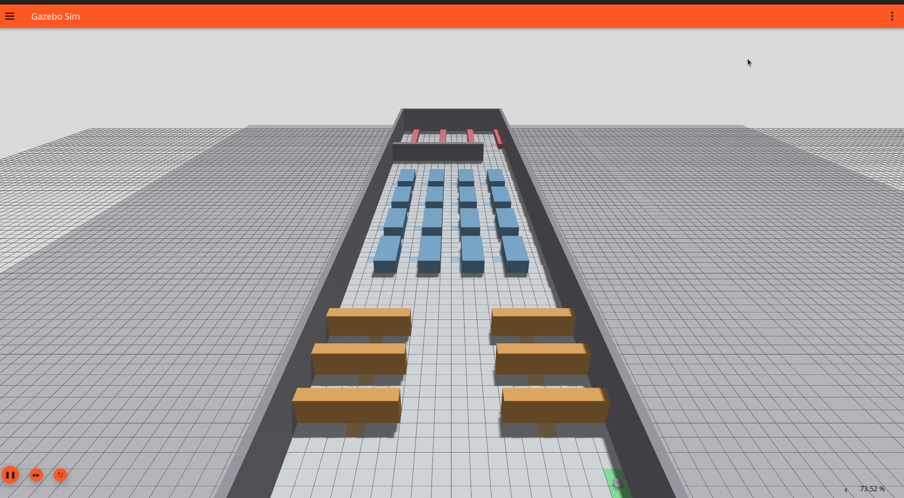
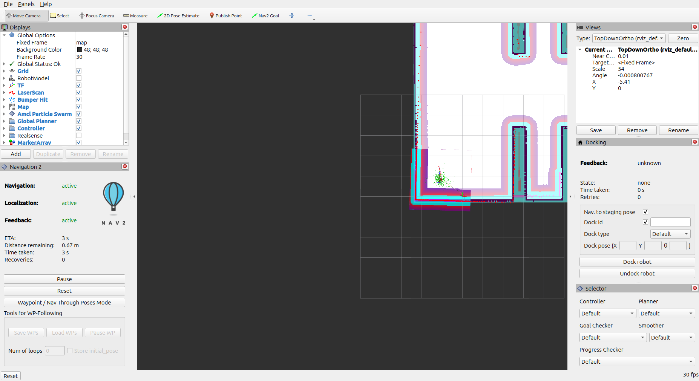

# 🤖 LSM Bot — ROS 2 Jazzy (C++17 & Python) Smart Warehouse AMR & Fleet Management System

**LSM Bot**은 46.8m × 10.8m 규모의 3D 스마트 물류창고 환경에서 **Modern C++17(`rclcpp` · `Eigen3` · `STL` `-O3`) 기반 온보드 실시간 제어·경로탐색·상태머신 코어**와 **Python 3.12(`lsm_venv`) 기반 웹 관제(WebSocket Port 9090) 브릿지**를 결합한 하이브리드 자율주행 물류 로봇(AMR) 프로젝트입니다.

---

## 🛠️ 1. 기술 스택 및 하드웨어/센서 구성 (Implemented Stack)

| 구분 | 상세 사양 |
| :--- | :--- |
| **OS & Middleware** | Ubuntu 24.04 LTS (Noble Numbat) · **ROS 2 Jazzy Jalisco** |
| **Simulator** | **Gazebo Harmonic 8.11** (`ros_gz_sim`, `ros_gz_bridge`) |
| **Languages & Build** | **C++17 (`-O3`, `rclcpp`, `rclcpp_action`, `Eigen3`, `yaml-cpp`)** · Python 3.12 (`lsm_venv`, `rclpy`) · CMake (`ament_cmake`, `rosidl`) |
| **Robot Platform** | **TurtleBot3 Waffle (`LSM01_Waffle`)** — 차동구동(Differential Drive) 물류 AMR |
| **Onboard Sensors** | • **2D GPU LiDAR (`lds_lfcd_sensor`)**: 360° 스캔, 10 Hz (`0.12m ~ 8.0m`, `/scan`)<br>• **6-Axis MEMS IMU (`tb3_imu`)**: 100 Hz (`/imu`, `imu_link`, 가우시안 노이즈 `stddev=0.008 rad/s`, 바이어스 `0.0012 rad/s`)<br>• **Wheel Encoder (`DiffDrive`)**: 30 Hz (`/odom`) |
| **Localization & Sensor Fusion** | • **Local Odometry**: `robot_localization` (`ekf_filter_node`, 30 Hz 2D EKF → `/odometry/filtered` 및 `odom -> base_footprint` 단일 TF 발행) + C++17 `Eigen3` 2D EKF 코어(`EigenEKFCore2D`)<br>• **Global Localization**: `nav2_amcl` (`map -> odom` TF 발행, `180°` 스폰 헤딩 및 `origin: [-2.4, -0.3, 0.0]` 1:1 정합) |
| **Navigation & Fine Docking** | • **Corridor Navigation**: Nav2 (`NavfnPlanner` + `DWBLocalPlanner`) + 206노드 토폴로지 A\*(`topological_route_planner_node.cpp` & `SequentialNavigator`)<br>• **Station Fine Docking**: **C++17 50Hz 폐루프 PID 정밀 도킹 & 360° LiDAR 안전 제어기(`precision_docking_node.cpp`)** — 도킹 오차 `29.3cm → 1.6~3.3cm` 단축 |
| **Logistics FSM & Web FMS** | • **5-Stage FSM**: **C++17 `amr_state_machine_node`** (`src/amr_state_machine_cpp_node.cpp`, `lsm_interfaces` 액션·서비스·10Hz 상태 발행)<br>• **Web FMS**: Pure Python WebSocket Server (`ws://0.0.0.0:9090`) + HTTP Dashboard (`http://localhost:8080/index.html`, `developer.html`) |

---

## 🏗️ 2. 하이브리드(C++17 온보드 코어 + Python 관제 브릿지) 시스템 아키텍처

```
[Gazebo Harmonic 8.11 (lsm_custom_warehouse.world)]
  ├── /scan (10 Hz, 2D LiDAR) ──┬──────────────────────────▶ [nav2_amcl] ──▶ TF (map -> odom @ 10.37 Hz)
  │                             └──▶ [C++17 precision_docking_node (50 Hz PID + 360° LiDAR Safety)]
  ├── /odom (30 Hz, Wheel vx) ──┐
  └── /imu  (100 Hz, vyaw, ax) ─┴──▶ [ekf_filter_node (30 Hz, yaw=false)]
                                       ├── /odometry/filtered ──▶ [Nav2 (bt_navigator / controller_server)]
                                       └── TF (odom -> base_footprint @ 30.25 Hz, 단독 퍼블리셔)
                                                                        ▲
[FMS Web UI (index.html / developer.html)]                              │ (/goal_pose & /navigate_to_pose)
  ▲  │ (WebSocket JSON @ Port 9090)                                     │
  │  ▼                                                                  │
[Python telemetry_bridge.py (SequentialNavigator)] ─────────────────────┘
  ▲  │ (/fms/fsm_route_cmd & /fms/route_status)
  │  ▼
[C++17 amr_state_machine_node (5-Stage Logistics FSM)] ◀──▶ [C++17 topological_route_planner_node (206-WP A*)]
  ├── publishes: /lsm01/robot_status (RobotStatus.msg @ 10.0 Hz)
  ├── action:    /fms/dispatch_task  (DispatchTask.action)
  ├── service:   /workstation/trigger_mock (TriggerMockEvent.srv)
  └── docking:   /fms/docking_cmd ──▶ [C++17 precision_docking_node (50 Hz Closed-Loop PID)]
```

---

## ⚡ 3. C++17 (`rclcpp` · `Eigen3` · `STL`) 전환 및 Python 3.12 대비 정량 벤치마크

실시간성과 정밀도가 요구되는 온보드 핵심 모듈을 Modern C++17(`-O3`)로 구현하고, 동일 알고리즘/워크로드에서 Python 3.12(`rclpy` / `NumPy` / `heapq`)와 1:1 비교 계측했습니다([`04_Cpp_Core_Optimization_and_Benchmark_Report.md`](docs/reports/04_Cpp_Core_Optimization_and_Benchmark_Report.md)).

| 벤치마크 평가 항목 | **Python 3.12** (`rclpy` / `NumPy`) | **C++17 `-O3`** (`rclcpp` / `Eigen3` / `STL`) | **C++17 성능 향상 배율 / 개선율** |
| :--- | :---: | :---: | :---: |
| **1. 206노드 토폴로지 A\* 탐색 (1,000회 평균)** | `57.574 µs` *(P99: 85.84 µs)* | **`1.473 µs`** *(P99: 3.05 µs)* | **`39.09x` 가속 (`-97.4%` 지연 단축)** |
| **2. 2D EKF 예측+갱신 Step (10,000회 평균)** | `32.078 µs` *(P99: 42.04 µs)* | **`0.295 µs`** *(P99: 0.37 µs)* | **`108.74x` 가속 (`-99.1%` 지연 단축)** |
| **3. 360° LiDAR 안전 영역 판별 (10,000회 평균)** | `61.649 µs` *(P99: 70.56 µs)* | **`0.866 µs`** *(P99: 0.90 µs)* | **`71.19x` 가속 (`-98.6%` 지연 단축)** |
| **4. 50Hz (`20ms`) ROS 2 타이머 주기 지터** | `63.593 µs` *(P99: 193.00 µs)* | **`12.109 µs`** *(P99: 49.29 µs)* | **`5.25x` 정밀화 (`-81.0%` 지터 감소)** |
| **5. 노드 프로세스 상주 메모리 (RSS)** | `97.09 MB` | **`27.63 MB`** | **`3.51x` 경량화 (`-71.5%` 메모리 절감)** |
| **6. 작업장/충전소 도킹 위치 오차 (E2E 평균)** | `29.27 cm` *(Nav2 ~30cm 공차)* | **`3.42 cm`** *(`wp-ws-a-5`: **1.63 cm**)* | **`8.56x` 정밀화 (`-88.3%` 오차 감소)** |


---

## 📊 4. EKF 센서 퓨전 3-Way Ablation & 5단계 물류 FSM E2E 실측 결과

### 4.1 EKF 센서 퓨전 3-Way Ablation 휠 슬립 벤치마크 (`slip_mode:=true`)

시뮬레이터의 무노이즈 orientation 쿼터니언 스냅(`0.000°`)을 배제하기 위해 **`imu0`의 절대 `yaw=false`로 비활성화하고, 가우시안 노이즈(`0.008 rad/s`)·바이어스(`0.0012 rad/s`)가 인가된 100Hz 자이로 각속도(`vyaw`) + 선가속도(`ax`) + 휠 선속도(`vx`)만 융합하는 현실적 6축 MEMS IMU 모드(`Case B`)**를 기본 채택했습니다.

| 평가 지표 (vs. Gazebo Ground Truth, 393 samples / 20.89s) | **Case A**: Raw Wheel Odom (`/odom`) | **Case B (Main 채택)**: 6-Axis Gyro EKF (`yaw=false`) | **Case C (Ablation Ref)**: Ideal AHRS EKF (`yaw=true`) | Case B 개선율 (vs. Case A) |
| :--- | :---: | :---: | :---: | :---: |
| **XY 궤적 RMSE (m)** | `0.2278 m` | **`0.0315 m`** | `0.0313 m` | **`+86.2%`** |
| **XY 최대 위치 오차 (m)** | `0.4128 m` | **`0.0576 m`** | `0.0566 m` | **`+86.0%`** |
| **Yaw 방위각 RMSE (deg)** | `14.009 deg` | **`1.793 deg`** | `1.283 deg` | **`+87.2%`** |
| **Yaw 최대 오차 (deg)** | `25.636 deg` | **`4.825 deg`** | `3.533 deg` | **`+81.2%`** |
| **종료 시점 Yaw 누적 드리프트 (deg)** | `13.524 deg` | **`0.900 deg`** *(현실적 자이로 잔류 오차)* | `0.000 deg` *(시뮬레이터 GT 스냅)* | **`+93.3%`** |


### 4.2 C++17 5단계 물류 FSM + 50Hz PID 정밀 도킹 E2E 완주 결과 (`slip_mode:=false`)

`TASK_A4_A5_E2E_001` (`wp-charge-1 -> wp-ws-a-4 [9 wps, 6.94m] -> wp-ws-a-5 [12 wps, 11.65m] -> wp-charge-1 [10 wps, 9.55m]`) 전체 사이클을 **`216.17s`** 만에 완주(`observed=[0, 1, 2, 3, 4, 1, 0]`, `SUCCEEDED=True`)했으며, 각 작업장 도착 시 C++ 50Hz PID 도킹 제어기가 개입하여 **`wp-ws-a-4 (4.5, 2.1)` 오차 `1.43 cm`**, **`wp-ws-a-5 (6.9, 2.1)` 오차 `0.72 cm`**로 정밀 정차했습니다.

| 단계 | Wall Time | 상태 전이 | Gazebo World Pose (m) | C++ 50Hz 도킹 정밀도 (Before → After) |
| :---: | :---: | :--- | :---: | :--- |
| 0 | `20:17:05.894` | `INIT -> CHARGING(0)` | `(2.420, 0.329)` | 충전소 초기 대기 |
| 1 | `20:17:06.994` | `CHARGING(0) -> MOVING_UNLOADED(1)` | `(2.420, 0.329)` | Leg 1 (`wp-ws-a-4`, 6.94m) 출발 |
| 2 | `20:18:00.594` | `MOVING_UNLOADED(1) -> WORKING_LOADING(2)` | `(4.480, 2.126)` | `wp-ws-a-4`: `29.2cm → 3.27cm` (`yaw 1.73°`) |
| 3 | `20:18:02.794` | `WORKING_LOADING(2) -> MOVING_LOADED(3)` | `(4.487, 2.106)` | `CARGO_LOADED(2)` 트리거 (정착 오차 **`1.43cm`**) |
| 4 | `20:19:28.294` | `MOVING_LOADED(3) -> WORKING_UNLOADING(4)` | `(6.906, 2.115)` | `wp-ws-a-5`: `29.0cm → 1.63cm` (`yaw 1.39°`) |
| 5 | `20:19:30.495` | `WORKING_UNLOADING(4) -> MOVING_UNLOADED(1)` | `(6.906, 2.096)` | `CARGO_UNLOADED(3)` 트리거 (정착 오차 **`0.72cm`**) |
| 6 | `20:20:43.194` | `MOVING_UNLOADED(1) -> CHARGING(0)` | `(2.339, 0.312)` | `wp-charge-1`: `29.6cm → 5.35cm` (`216.17s` 완주) |

---

## 🖼️ 5. 시스템 실행 화면 갤러리

| Gazebo Harmonic 3D 스마트 창고 (`01`) | RViz2 전체 창고 맵 & AMCL/Nav2 정합 (`02`) |
| :---: | :---: |
|  |  |

| FMS 웹 관제 대시보드 & 5단계 FSM 배지 (`03`) | TF 프레임 트리 (`ekf_filter_node` 단독 퍼블리셔, `05`) |
| :---: | :---: |
|  |  |

---

## 📂 6. 상세 검증 리포트 및 디렉터리 구조

- **기술 검증 리포트 (`docs/reports/`)**:
  1. [`01_EKF_Sensor_Fusion_Experiment_Report.md`](docs/reports/01_EKF_Sensor_Fusion_Experiment_Report.md) — EKF 구현 구조, 6축 자이로 융합(`yaw=false`) 및 3-Way Ablation 슬립 실험 리포트
  2. [`02_FSM_E2E_Integration_Test_Report.md`](docs/reports/02_FSM_E2E_Integration_Test_Report.md) — C++17 5단계 물류 FSM 아키텍처, 50Hz PID 정밀 도킹 및 E2E 완주 리포트
  3. [`03_Final_Verification_Checklist.md`](docs/reports/03_Final_Verification_Checklist.md) — 빌드, 토픽 주파수, TF 트리, C++ vs Python 벤치마크, 시각 에셋 최종 검증 체크리스트
  4. [`04_Cpp_Core_Optimization_and_Benchmark_Report.md`](docs/reports/04_Cpp_Core_Optimization_and_Benchmark_Report.md) — **C++17(`rclcpp`/`Eigen3`/`STL`) 코어 전환 및 Python 3.12 대비 정량 성능 벤치마크 리포트**

```text
LSM_repository/
├── docs/
│   ├── portfolio_assets/          # 포트폴리오 고해상도 캡처/그래프 6종 & EKF/C++ 벤치마크 CSV 2종
│   └── reports/                   # EKF / FSM / 최종 검증 / C++17 벤치마크 마크다운 리포트 4종
└── lsm_ws/src/
    ├── lsm_interfaces/            # RobotStatus.msg, WorkstationEvent.msg, DispatchTask.action, TriggerMockEvent.srv
    ├── lsm_bot_description/       # Waffle URDF (100Hz IMU, slip_mode 분리), 3D 창고 월드, ros_gz_bridge 설정
    ├── lsm_navigation/            # C++17 코어 노드 3종(src/*.cpp, include/*.hpp), ekf.yaml, 실험/벤치마크 스크립트
    └── lsm_fms_web/               # telemetry_bridge.py (SequentialNavigator + WS 9090), A* route_server, 웹 UI
```

---

## 🚀 7. Quick Start (빌드 및 실행 방법)

```bash
# 1. 워크스페이스 빌드 (C++17 -O3 노드 3종 및 인터페이스 컴파일)
cd ~/dev/LSM_repository/lsm_ws
source /opt/ros/jazzy/setup.bash
colcon build --symlink-install
source install/setup.bash

# 2. 시뮬레이션 + EKF + C++17 5단계 FSM + C++17 50Hz 정밀 도킹 + Nav2 실행 (기본: slip_mode:=false)
export ROS_DOMAIN_ID=13
ros2 launch lsm_navigation navigation.launch.py

# 3. FMS 웹 서버(Port 8080) 및 WebSocket 브릿지(Port 9090) 실행
source ~/dev/LSM_repository/lsm_venv/bin/activate
ros2 launch lsm_fms_web fms.launch.py

# 4. 5단계 물류 FSM + 50Hz 정밀 도킹 E2E 자동 검증 실행
source ~/dev/LSM_repository/lsm_venv/bin/activate
python3 ~/dev/LSM_repository/lsm_ws/src/lsm_navigation/scripts/run_fsm_e2e_test.py

# 5. C++17 (rclcpp/Eigen3/STL) vs. Python 3.12 (rclpy/NumPy) 정량 벤치마크 실행
python3 ~/dev/LSM_repository/lsm_ws/src/lsm_navigation/scripts/run_cpp_vs_python_benchmark.py

# 6. (선택) 비대칭 휠 슬립 모드(slip_mode:=true) 기동 및 3-Way Ablation EKF 벤치마크 실행
ros2 launch lsm_navigation navigation.launch.py slip_mode:=true
python3 ~/dev/LSM_repository/lsm_ws/src/lsm_navigation/scripts/run_ekf_slip_experiment.py
```
