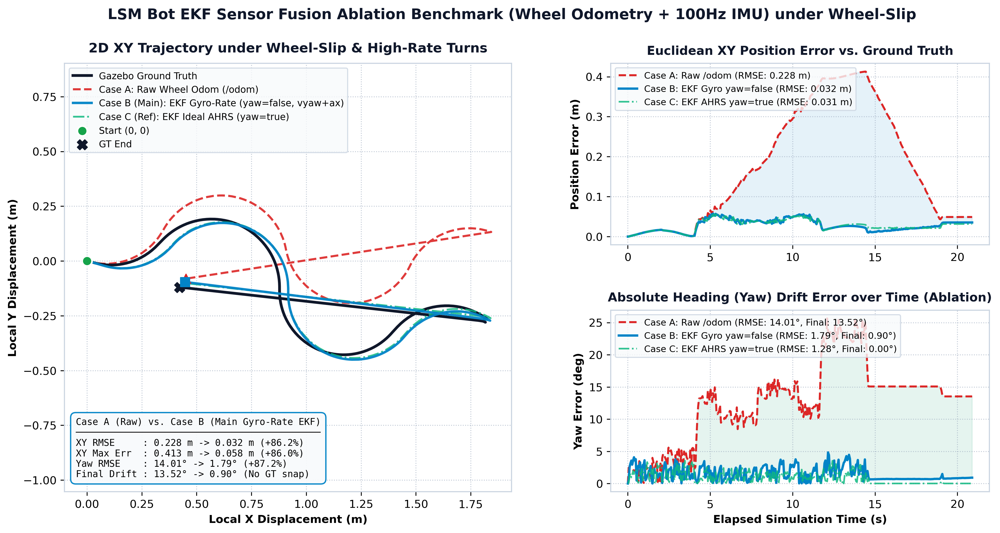
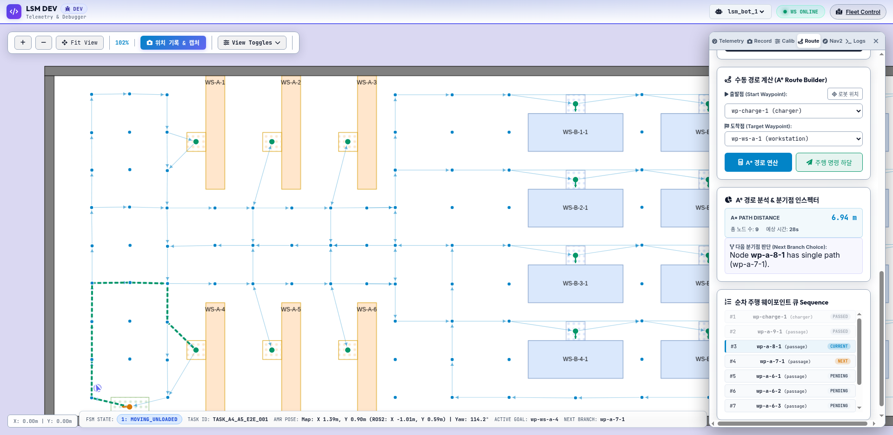
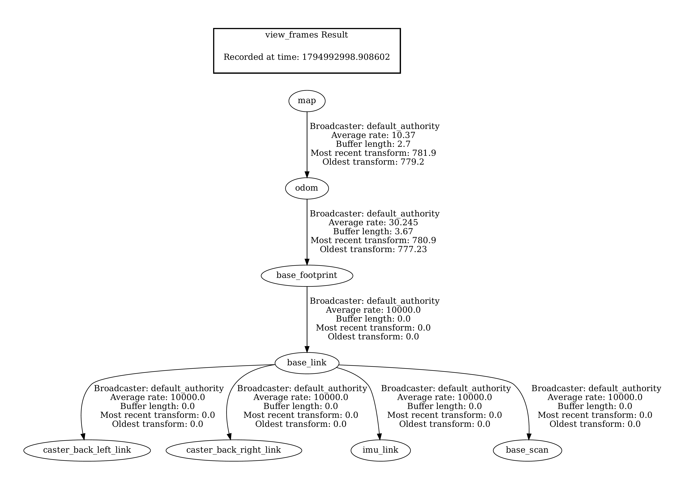

# 🤖 LSM Bot — ROS 2 Jazzy Smart Warehouse AMR & Fleet Management System

**LSM Bot**은 46.8m × 10.8m 규모의 3D 스마트 물류창고 환경에서 **2D SLAM 점유 지도 정합**, **206개 노드 토폴로지 A\* 경로 탐색 및 10Hz 순차 주행 디스패처(`SequentialNavigator`)**, **`robot_localization` 기반 2D EKF 센서 퓨전(Wheel Odometry + 100Hz 6-Axis MEMS IMU)**, **5단계 물류 FSM 상태 머신(`amr_state_machine_node`)**, 그리고 **Pure Python WebSocket(Port 9090) 기반 실시간 웹 관제 대시보드**를 엔드투엔드(E2E)로 통합·검증한 자율주행 물류 로봇 프로젝트입니다.

---

## 🛠️ 1. 기술 스택 및 하드웨어/센서 구성 (Implemented Stack)

| 구분 | 상세 사양 |
| :--- | :--- |
| **OS & Middleware** | Ubuntu 24.04 LTS (Noble Numbat) · **ROS 2 Jazzy Jalisco** |
| **Simulator** | **Gazebo Harmonic 8.11** (`ros_gz_sim`, `ros_gz_bridge`) |
| **Language & Env** | Python 3.12 (`lsm_venv` 독립 가상환경) · CMake (`ament_cmake`, `rosidl`) |
| **Robot Platform** | **TurtleBot3 Waffle (`LSM01_Waffle`)** — 차동구동(Differential Drive) 물류 AMR |
| **Onboard Sensors** | • **2D GPU LiDAR (`lds_lfcd_sensor`)**: 360° 스캔, 10 Hz (`0.12m ~ 8.0m`, `/scan`)<br>• **6-Axis MEMS IMU (`tb3_imu`)**: 100 Hz (`/imu`, `imu_link`, 가우시안 노이즈 `stddev=0.008 rad/s`, 바이어스 `0.0012 rad/s`)<br>• **Wheel Encoder (`DiffDrive`)**: 30 Hz (`/odom`) |
| **Localization & Sensor Fusion** | • **Local Odometry**: `robot_localization` (`ekf_filter_node`, 30 Hz 2D EKF → `/odometry/filtered` 및 `odom -> base_footprint` 단일 TF 발행)<br>• **Global Localization**: `nav2_amcl` (`map -> odom` TF 발행, `180°` 스폰 헤딩 및 `origin: [-2.4, -0.3, 0.0]` 1:1 정합) |
| **Navigation & Route Dispatch** | • **Global/Local Control**: Nav2 (`NavfnPlanner` + `DWBLocalPlanner`)<br>• **Topological Fleet Routing**: 206개 웨이포인트 / 208개 방향성 엣지 기반 **A\* 최단 경로 서버** + 10Hz **`SequentialNavigator`** 릴레이 디스패처 |
| **Logistics FSM & Web FMS** | • **5-Stage FSM**: `amr_state_machine_node` (`lsm_interfaces`: `RobotStatus.msg`, `WorkstationEvent.msg`, `DispatchTask.action`, `TriggerMockEvent.srv`)<br>• **Web FMS**: Pure Python WebSocket Server (`ws://0.0.0.0:9090`) + HTTP Dashboard (`http://localhost:8080/index.html`, `developer.html`) |

---

## 🏗️ 2. 시스템 아키텍처 및 5단계 물류 FSM

### 2.1 전체 노드 및 TF 파이프라인

```
[Gazebo Harmonic 8.11 (lsm_custom_warehouse.world)]
  ├── /scan (10 Hz, 2D LiDAR) ─────────────────────────────▶ [nav2_amcl] ──▶ TF (map -> odom @ 10.3 Hz)
  ├── /odom (30 Hz, Wheel vx) ──┐
  └── /imu  (100 Hz, vyaw, ax) ─┴─▶ [ekf_filter_node (30 Hz)]
                                      ├── /odometry/filtered ──▶ [Nav2 (bt_navigator / controller_server)]
                                      └── TF (odom -> base_footprint @ 30.3 Hz, 단독 퍼블리셔)
                                                                       ▲
[FMS Web UI (index.html / developer.html)]                             │ (/goal_pose & /navigate_to_pose)
  ▲  │ (WebSocket JSON @ Port 9090)                                    │
  │  ▼                                                                 │
[telemetry_bridge.py (SequentialNavigator, 206-Node A*)] ──────────────┘
  ▲  │ (/fms/fsm_route_cmd & /fms/route_status)
  │  ▼
[amr_state_machine_node (5-Stage Logistics FSM)]
  ├── publishes: /lsm01/robot_status (RobotStatus.msg @ 10.0 Hz)
  ├── action:    /fms/dispatch_task  (DispatchTask.action)
  └── service:   /workstation/trigger_mock (TriggerMockEvent.srv)
```

### 2.2 5단계 물류 상태 머신 (`RobotStatus.msg`)

1. **`0: CHARGING`**: 충전소(`wp-charge-1`) 대기 및 배터리 충전 상태
2. **`1: MOVING_UNLOADED`**: 공차 주행 (픽업 스테이션 이동 또는 하역 후 충전소 복귀)
3. **`2: WORKING_LOADING`**: 픽업 스테이션 도착 후 적재 완료 이벤트(`CARGO_LOADED=2`) 대기
4. **`3: MOVING_LOADED`**: 실차 주행 (픽업 스테이션 → 목적지 하역 스테이션 이송)
5. **`4: WORKING_UNLOADING`**: 하역 스테이션 도착 후 하역 완료 이벤트(`CARGO_UNLOADED=3`) 대기

---

## 📊 3. 핵심 실험 및 검증 결과

### 3.1 EKF 센서 퓨전 3-Way Ablation 휠 슬립 벤치마크 (`slip_mode:=true`)

Gazebo의 `gz-sim-imu-system`은 각속도/선가속도에는 노이즈를 인가하지만 `orientation` 쿼터니언은 무노이즈 Ground Truth로 출력합니다. 본 프로젝트는 면접 및 실차 적용 관점에서 **`imu0`의 무노이즈 절대 `yaw`를 끄고(`yaw=false`), 노이즈·바이어스가 포함된 100Hz 자이로 각속도(`vyaw`) + 선가속도(`ax`) + 휠 선속도(`vx`)만 융합하는 현실적 6축 MEMS IMU 모드(`Case B`)**를 기본 채택했으며, 비대칭 저마찰 슬립 조건(`wheel_left=0.35`, `wheel_right=0.28`, `caster=0.01`)에서 3-Way Ablation 정량 비교를 수행했습니다.

| 평가 지표 (vs. Gazebo Ground Truth, 393 samples / 20.89s) | **Case A**: Raw Wheel Odom (`/odom`) | **Case B (Main 채택)**: 6-Axis Gyro EKF (`yaw=false`) | **Case C (Ablation Ref)**: Ideal AHRS EKF (`yaw=true`) | Case B 개선율 (vs. Case A) |
| :--- | :---: | :---: | :---: | :---: |
| **XY 궤적 RMSE (m)** | `0.2278 m` | **`0.0315 m`** | `0.0313 m` | **`+86.2%`** |
| **XY 최대 위치 오차 (m)** | `0.4128 m` | **`0.0576 m`** | `0.0566 m` | **`+86.0%`** |
| **Yaw 방위각 RMSE (deg)** | `14.009 deg` | **`1.793 deg`** | `1.283 deg` | **`+87.2%`** |
| **Yaw 최대 오차 (deg)** | `25.636 deg` | **`4.825 deg`** | `3.533 deg` | **`+81.2%`** |
| **종료 시점 Yaw 누적 드리프트 (deg)** | `13.524 deg` | **`0.900 deg`** *(현실적 자이로 잔류 오차)* | `0.000 deg` *(시뮬레이터 GT 스냅)* | **`+93.3%`** |



### 3.2 5단계 물류 FSM E2E 통합 주행 결과 (`slip_mode:=false` 기본 주행 모드)

일반 물류 주행 시에는 대칭 정상 마찰(`slip_mode:=false`, `mu=1.0`)이 기본 적용되어, `TASK_A4_A5_E2E_001` (`wp-charge-1 -> wp-ws-a-4 [9 wps, 6.94m] -> wp-ws-a-5 [12 wps, 11.65m] -> wp-charge-1 [10 wps, 9.55m]`) 전체 사이클을 **`218.35s`** 만에 완주(`observed=[0, 1, 2, 3, 4, 1, 0]`, `SUCCEEDED=True`)했습니다.

| 단계 | Wall Time | 상태 전이 | ROS2 Map Pose (m) | Gazebo World Pose (m) | 비고 |
| :---: | :---: | :--- | :---: | :---: | :--- |
| 0 | `17:58:07.568` | `INIT -> CHARGING(0)` | `(0.007, 0.028)` | `(2.407, 0.328)` | 충전소 초기 대기 |
| 1 | `17:58:09.472` | `CHARGING(0) -> MOVING_UNLOADED(1)` | `(0.007, 0.028)` | `(2.407, 0.328)` | Leg 1 (`wp-ws-a-4`, 6.94m) 출발 |
| 2 | `17:59:03.584` | `MOVING_UNLOADED(1) -> WORKING_LOADING(2)` | `(1.862, 1.977)` | `(4.262, 2.277)` | `wp-ws-a-4` 도착 (`dist=0.29m`) |
| 3 | `17:59:05.690` | `WORKING_LOADING(2) -> MOVING_LOADED(3)` | `(1.949, 1.895)` | `(4.349, 2.195)` | `CARGO_LOADED(2)` 트리거, Leg 2 (11.65m) 출발 |
| 4 | `18:00:34.746` | `MOVING_LOADED(3) -> WORKING_UNLOADING(4)` | `(4.303, 2.010)` | `(6.703, 2.310)` | `wp-ws-a-5` 도착 (`dist=0.29m`) |
| 5 | `18:00:37.026` | `WORKING_UNLOADING(4) -> MOVING_UNLOADED(1)` | `(4.357, 1.994)` | `(6.757, 2.294)` | `CARGO_UNLOADED(3)` 트리거, Leg 3 (9.55m) 복귀 |
| 6 | `18:01:47.710` | `MOVING_UNLOADED(1) -> CHARGING(0)` | `(0.183, 0.229)` | `(2.583, 0.529)` | `wp-charge-1` 복귀 완료 (`218.35s`) |

---

## 🖼️ 4. 시스템 실행 화면 갤러리

| Gazebo Harmonic 3D 스마트 창고 (`01`) | RViz2 전체 창고 맵 & AMCL/Nav2 정합 (`02`) |
| :---: | :---: |
|  |  |

| FMS 웹 관제 대시보드 & 5단계 FSM 배지 (`03`) | TF 프레임 트리 (`ekf_filter_node` 단독 퍼블리셔, `05`) |
| :---: | :---: |
|  |  |

---

## 📂 5. 상세 검증 리포트 및 디렉터리 구조

- **기술 검증 리포트 (`docs/reports/`)**:
  1. [`01_EKF_Sensor_Fusion_Experiment_Report.md`](docs/reports/01_EKF_Sensor_Fusion_Experiment_Report.md) — EKF 구현 구조, 6축 자이로 융합(`yaw=false`) 및 3-Way Ablation 슬립 실험 리포트
  2. [`02_FSM_E2E_Integration_Test_Report.md`](docs/reports/02_FSM_E2E_Integration_Test_Report.md) — 5단계 물류 FSM 아키텍처, `lsm_interfaces` 명세 및 E2E 완주 타임스탬프 리포트
  3. [`03_Final_Verification_Checklist.md`](docs/reports/03_Final_Verification_Checklist.md) — 빌드, 토픽 주파수(`30 Hz / 90 Hz / 10 Hz`), TF 트리, 시각 에셋 최종 검증 체크리스트

```text
LSM_repository/
├── docs/
│   ├── portfolio_assets/          # 포트폴리오 고해상도 캡처 5종 & EKF 비교 CSV
│   └── reports/                   # EKF / FSM / 최종 검증 마크다운 리포트 3종
└── lsm_ws/src/
    ├── lsm_interfaces/            # RobotStatus.msg, WorkstationEvent.msg, DispatchTask.action, TriggerMockEvent.srv
    ├── lsm_bot_description/       # Waffle URDF (100Hz IMU, slip_mode 분리), 3D 창고 월드, ros_gz_bridge 설정
    ├── lsm_navigation/            # ekf.yaml, nav2_params.yaml, amr_state_machine_node.py, 실험/E2E 스크립트
    └── lsm_fms_web/               # telemetry_bridge.py (SequentialNavigator + WS 9090), A* route_server, 웹 UI
```

---

## 🚀 6. Quick Start (빌드 및 실행 방법)

```bash
# 1. 워크스페이스 빌드
cd ~/dev/LSM_repository/lsm_ws
source /opt/ros/jazzy/setup.bash
colcon build --symlink-install
source install/setup.bash

# 2. 시뮬레이션 + EKF + 5단계 FSM + Nav2 실행 (기본 정상 마찰: slip_mode:=false)
export ROS_DOMAIN_ID=13
ros2 launch lsm_navigation navigation.launch.py

# 3. FMS 웹 서버(Port 8080) 및 WebSocket 브릿지(Port 9090) 실행
source ~/dev/LSM_repository/lsm_venv/bin/activate
ros2 launch lsm_fms_web fms.launch.py

# 4. 5단계 물류 FSM E2E 자동 검증 실행
source ~/dev/LSM_repository/lsm_venv/bin/activate
python3 ~/dev/LSM_repository/lsm_ws/src/lsm_navigation/scripts/run_fsm_e2e_test.py

# 5. (선택) 비대칭 휠 슬립 모드(slip_mode:=true) 기동 및 3-Way Ablation EKF 벤치마크 실행
ros2 launch lsm_navigation navigation.launch.py slip_mode:=true
python3 ~/dev/LSM_repository/lsm_ws/src/lsm_navigation/scripts/run_ekf_slip_experiment.py
```
