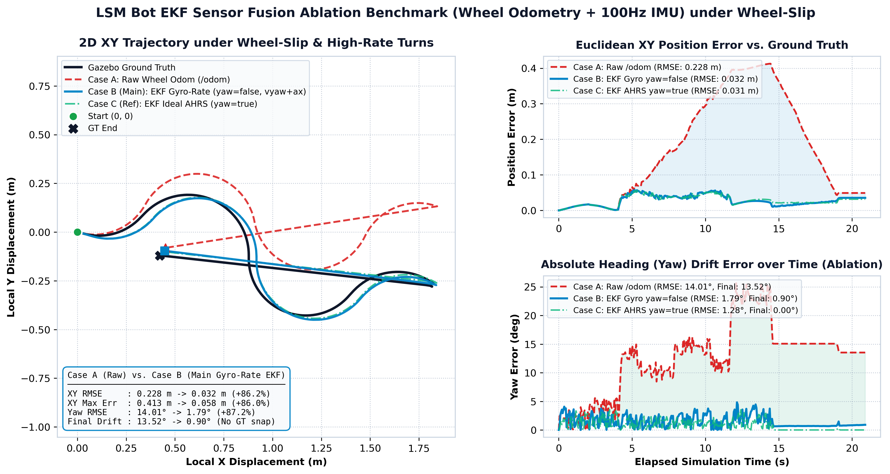

# EKF 센서 퓨전(`robot_localization`) 구현 및 3-Way Ablation 휠 슬립 정량 실험 리포트

- **프로젝트**: LSM Bot (Smart Warehouse Autonomous Mobile Robot & FMS)
- **작성일**: 2026-11-18
- **실행 환경**: Ubuntu 24.04 LTS, ROS 2 Jazzy, Gazebo Harmonic 8.11, Python 3.12 (`lsm_venv`), `ros-jazzy-robot-localization` (`3.8.4-1noble.20261105.105419`)

---

## 1. 개요 및 목적

기존 LSM Bot 시뮬레이션은 Gazebo `gz-sim-diff-drive-system` 플러그인이 계산한 순수 휠 오도메트리(`/odom`)만으로 `odom -> base_footprint` TF를 직접 발행하고 있었습니다. 이 방식은 다음과 같은 구조적 한계가 존재합니다.

1. **슬립 및 급선회 취약성**: 바퀴 미끄러짐(Wheel Slip)이나 제자리 급선회(`±1.82 rad/s`), 급가감속 시 엔코더 기반 적분 오차가 급격히 누적되어 Yaw 헤딩 및 XY 위치가 실제 포즈(Ground Truth)에서 크게 이탈합니다.
2. **시뮬레이터 IMU Orientation `0.000°` 수렴 함정 (Ground-Truth Snap Artifact)**:
   - Gazebo Harmonic의 `gz-sim-imu-system` 플러그인은 `<angular_velocity>`와 `<linear_acceleration>`에는 URDF에 정의된 가우시안 노이즈 및 바이어스를 인가하지만, `msg.orientation` 쿼터니언은 시뮬레이터 내부 무노이즈 Ground Truth 자세로부터 직접 생성합니다.
   - 만약 `ekf.yaml`의 `imu0_config`에서 절대 방위각 `yaw = true`를 그대로 활성화하면, 직진·정지 구간에서 EKF 헤딩 오차가 소수점 셋째 자리까지 `0.000° (+100%)`로 스냅(Snap)되는 비현실적 결과가 발생합니다.

이를 해결하기 위해 본 프로젝트에서는 다음 두 가지를 구현 및 검증했습니다:
- **현실적 6축 MEMS IMU 자이로 각속도 기반 EKF (`Case B`, 기본 채택)**: `imu0_config`에서 무노이즈 절대 `yaw = false`로 비활성화하고, 가우시안 노이즈(`stddev=0.008 rad/s`) 및 턴온 바이어스(`bias_mean=0.0012 rad/s`)가 인가된 100Hz 자이로 각속도(`vyaw = true`)와 선가속도(`ax = true`), 그리고 휠 엔코더의 종방향 선속도(`/odom`: `vx = true`)만 융합합니다.
- **3-Way Ablation 비교 벤치마크**: 동일 슬립 주행 궤적에서 `Case A (Raw /odom)` vs. `Case B (Main: 6-Axis Gyro-Rate EKF, yaw=false)` vs. `Case C (Ablation Ref: Ideal AHRS EKF, yaw=true)`를 동시 계측하여 센서 모델링 차이를 정량 규명했습니다.

---

## 2. EKF 센서 퓨전 아키텍처 및 구현 내역

### 2.1 TF 파이프라인 및 데이터 흐름

```
[Gazebo Harmonic 8.11]
  ├── gz-sim-diff-drive-system (<tf_topic> 제거) ──▶ /odom (30 Hz: vx 융합, 슬립 오염 vyaw/vy 배제)
  └── tb3_imu sensor (100 Hz, MEMS Noise & Bias) ──▶ /imu  (imu_link, 100 Hz: vyaw, ax 융합, yaw=false)
                                                            │
                                                            ▼
[robot_localization :: ekf_filter_node (30 Hz, two_d_mode: true)]
  ├── publishes: /odometry/filtered (map/odom frame fused odometry)
  └── broadcasts: odom -> base_footprint TF (단독 퍼블리셔)
                                                            │
                        ┌───────────────────────────────────┴──────────────────────────┐
                        ▼                                                              ▼
       [Nav2 Stack (nav2_params.yaml)]                             [FMS Telemetry Bridge]
         - bt_navigator (odom_topic: /odometry/filtered)             - telemetry_bridge.py
         - controller_server (odom_topic: /odometry/filtered)          (/odometry/filtered 우선 구독,
         - amcl (map -> odom 글로벌 드리프트 보정)                      미수신 시 2s 후 /odom 폴백)
```

### 2.2 패키지 및 설정 변경 요약

| 구분 | 대상 파일 | 주요 변경 내용 |
| :--- | :--- | :--- |
| 의존성 | [`lsm_navigation/package.xml`](../../lsm_ws/src/lsm_navigation/package.xml) | `<exec_depend>robot_localization</exec_depend>` 추가 |
| URDF / 센서 | [`lsm_bot_description/urdf/turtlebot3_waffle_gz.urdf`](../../lsm_ws/src/lsm_bot_description/urdf/turtlebot3_waffle_gz.urdf) | `DiffDrive` 내 `<tf_topic>tf</tf_topic>` 비활성화, 기본 휠 마찰 대칭 복원(`mu1/mu2=1.0`), 100Hz 6축 MEMS IMU(`tb3_imu`, 각속도 `stddev=0.008 rad/s, bias_mean=0.0012 rad/s`, 선가속도 `stddev=1.7e-2 m/s²`) 구성 |
| 슬립 모드 분리 | [`lsm_bot_description/launch/spawn_waffle_warehouse.launch.py`](../../lsm_ws/src/lsm_bot_description/launch/spawn_waffle_warehouse.launch.py) | `slip_mode:=false`(기본 양산 주행: 좌/우 마찰 `1.0`)와 `slip_mode:=true`(슬립 벤치마크: 좌 `0.35`, 우 `0.28`, 캐스터 `0.01`) 런치 인자 동적 분리 |
| 브릿지 | [`lsm_bot_description/config/ros_gz_bridge.yaml`](../../lsm_ws/src/lsm_bot_description/config/ros_gz_bridge.yaml) | `imu` (`sensor_msgs/msg/Imu` <-> `gz.msgs.IMU`, `GZ_TO_ROS`, `frame_id: "imu_link"`), `ground_truth_poses` (`/world/lsm_custom_warehouse/dynamic_pose/info` <-> `tf2_msgs/msg/TFMessage`) 추가, raw `tf` 브릿지 비활성화 |
| 메인 EKF 설정 | [`lsm_navigation/config/ekf.yaml`](../../lsm_ws/src/lsm_navigation/config/ekf.yaml) | 30Hz 2D EKF (`Case B`: `/odom` `[vx]` + `/imu` `[vyaw, ax]`, `yaw=false`, `publish_tf: true`) |
| Ablation 비교 설정 | [`lsm_navigation/config/ekf_ahrs_ref.yaml`](../../lsm_ws/src/lsm_navigation/config/ekf_ahrs_ref.yaml) | `Case C` 참조 노드(`ekf_ahrs_ref_node`, `/odometry/filtered_ahrs`, `yaw=true`, `publish_tf: false`) |
| 런치 및 Nav2 | [`lsm_navigation/launch/navigation.launch.py`](../../lsm_ws/src/lsm_navigation/launch/navigation.launch.py), [`nav2_params.yaml`](../../lsm_ws/src/lsm_navigation/config/nav2_params.yaml) | `ekf_filter_node` 런치 등록, `slip_mode` 인자 전달, `bt_navigator` 및 `controller_server`의 `odom_topic: /odometry/filtered` 연동 |

---

## 3. EKF 상태 벡터 및 Q / R 공분산 튜닝 근거

[`ekf.yaml`](../../lsm_ws/src/lsm_navigation/config/ekf.yaml)의 상태 벡터는 REP-105 및 `robot_localization` 표준 15차원 상태를 사용합니다:
`[x, y, z, roll, pitch, yaw, vx, vy, vz, vroll, vpitch, vyaw, ax, ay, az]` (`two_d_mode: true`).

### 3.1 센서 입력 행렬 (`odom0`, `imu0`) 설계 근거

1. **`odom0: /odom` (30 Hz)**
   - `odom0_config`: `[false, false, false,  false, false, false,  true, false, false,  false, false, false,  false, false, false]`
   - **`vx = true`**: 휠 엔코더로부터 전진 선속도(`vx`)만 융합합니다.
   - **`vy = false`**: Gazebo `DiffDrive`는 twist 공분산을 `0.0`(`robot_localization` 내부에서 `1e-9`로 치환)으로 발행하므로, `vy = true`로 두면 고속 S자 선회 시 발생하는 물리적 횡슬립 구간에서 과도한 zero-side-slip 구속이 걸립니다. 대신 `vy = false`로 두고 프로세스 노이즈 `Q(vy) = 1e-4`로 비홀로노믹 횡속도를 자연스럽게 감쇠시킵니다.
   - **`vyaw = false`**: 비대칭 휠 슬립 시 가장 크게 왜곡되는 값이 양 바퀴 속도차 기반 각속도(`(v_R - v_L)/W`)입니다. 이를 배제하여 슬립 각속도가 100Hz IMU 자이로를 간섭하지 않도록 차단했습니다.
2. **`imu0: /imu` (100 Hz, `imu_link`)**
   - `imu0_config`: `[false, false, false,  false, false, false,  false, false, false,  false, false, true,  true, false, false]`
   - **`yaw = false`**: 시뮬레이터의 무노이즈 orientation 쿼터니언 융합(GT 스냅 현상)을 원천 차단했습니다.
   - **`vyaw = true`, `ax = true`**: 가우시안 노이즈(`stddev=0.008 rad/s`)와 바이어스(`0.0012 rad/s`)가 포함된 100Hz 자이로 각속도(`vyaw`) 및 종방향 선가속도(`ax`)만 융합하여 실제 6축 MEMS IMU 데드레커닝과 동일한 조건을 구현했습니다.

### 3.2 15×15 프로세스 노이즈 공분산(`Q`) 튜닝

| 상태 변수 | `Q` 대각 값 | `P0` 대각 값 | 튜닝 근거 |
| :--- | :---: | :---: | :--- |
| `x, y` | `0.05` | `1e-9` | 속도 적분 시 지터 없이 부드러운 위치 예측 허용 |
| `yaw` | `0.02` | `1e-9` | 100Hz 자이로 각속도(`vyaw`) 적분 시 급격한 점프 없이 연속적인 헤딩 추정 유지 |
| `vx` | `0.05` | `1e-9` | 휠 오도메트리 종방향 선속도 변화를 지연 없이 추적 |
| `vy` | `0.0001` | `1e-9` | 비홀로노믹 차동구동 특성상 미관측 횡속도(`vy`) 발산을 억제하면서 S자 선회 시 유연성 확보 |
| `vyaw` | `0.04` | `1e-9` | 급선회(`1.82 rad/s`) 시 100Hz IMU 자이로 관측치를 즉각 반영 |
| `ax` | `0.001` | `1e-9` | 가속도계 바이어스(`0.01 m/s²`)가 정지 구간에서 선속도 `vx` 드리프트로 누적되는 현상 방지 |

---

## 4. 휠 슬립 조건(`slip_mode:=true`) 3-Way Ablation 정량 실험

### 4.1 실험 조건 및 9단계 기동 프로파일

- **실행 명령**:
  ```bash
  ros2 launch lsm_navigation navigation.launch.py slip_mode:=true
  python3 lsm_ws/src/lsm_navigation/scripts/run_ekf_slip_experiment.py
  ```
- **물리 마찰 설정 (`slip_mode:=true`)**: `wheel_left_link` (`mu1/mu2 = 0.35`), `wheel_right_link` (`mu1/mu2 = 0.28`), 캐스터 (`mu1/mu2 = 0.01`) — 일반 주행 시에는 `slip_mode:=false`(`mu1/mu2 = 1.0`)가 기본 적용됩니다.
- **실험 시작 포즈**: 중앙 동-서 통로 `GT = (2.12 m, 5.15 m, 4.2 deg)`
- **기동 프로파일** (`20.89s` 시뮬레이션 기록, 총 **393개 동기 샘플**):
  1. `Phase 1a/1b`: 제자리 최대 각속도 급선회 및 급반전 (`v=0.00 m/s, w=±1.82 rad/s`, 각 `2.0s`)
  2. `Phase 2a~2d`: 고속 S자 슬라럼 연속 기동 (`v=0.42 m/s, w=±1.40 rad/s`, `1.3s -> 2.5s -> 2.5s -> 1.3s`)
  3. `Phase 3a`: 급제동 J-Turn 선회 (`v=0.00 m/s, w=+1.82 rad/s, dt=2.8s`)
  4. `Phase 3b`: 직선 고속 대시 (`v=0.42 m/s, w=0.00 rad/s, dt=4.5s` — 누적된 Yaw 오차가 XY 위치 오차로 발산하는 구간)
  5. `Phase 4`: 완전 정지 및 안정화 (`v=0.00 m/s, w=0.00 rad/s, dt=2.0s`)

### 4.2 3-Way Ablation 실측 정량 비교표 ([`ekf_comparison.csv`](../portfolio_assets/ekf_comparison.csv))

| 평가 지표 (vs. Gazebo Ground Truth) | **Case A**: Raw Wheel Odom (`/odom`) | **Case B (Main 채택)**: 6-Axis Gyro-Rate EKF (`yaw=false`) | **Case C (Ablation Ref)**: Ideal AHRS EKF (`yaw=true`) | Case B 개선율 (vs. Case A) |
| :--- | :---: | :---: | :---: | :---: |
| **XY 궤적 RMSE (m)** | `0.2278 m` | **`0.0315 m`** | `0.0313 m` | **`+86.2%`** (`0.1963 m` 감소) |
| **XY 최대 위치 오차 (m)** | `0.4128 m` | **`0.0576 m`** | `0.0566 m` | **`+86.0%`** (`0.3552 m` 감소) |
| **Yaw 방위각 RMSE (deg)** | `14.009 deg` | **`1.793 deg`** | `1.283 deg` | **`+87.2%`** (`12.216°` 감소) |
| **Yaw 최대 오차 (deg)** | `25.636 deg` | **`4.825 deg`** | `3.533 deg` | **`+81.2%`** (`20.811°` 감소) |
| **종료 시점 Yaw 누적 드리프트 (deg)** | `13.524 deg` | **`0.900 deg`** *(현실적 자이로 잔류 오차)* | `0.000 deg` *(시뮬레이터 GT 스냅)* | **`+93.3%`** (`12.624°` 감소) |

> **Ablation 핵심 분석 결론**:
> - **Case A (`Raw /odom`)**는 비대칭 휠 슬립으로 인해 회전 구간에서 최대 `25.636°`까지 헤딩이 틀어지고, 종료 시점에도 `13.524°`의 영구 Yaw 드리프트와 `0.4128 m`의 최대 위치 이탈이 발생했습니다.
> - **Case B (`Main, yaw=false`)**는 시뮬레이터의 무노이즈 orientation 도움 없이 오직 노이즈·바이어스가 포함된 100Hz 자이로 각속도(`vyaw`)와 선가속도(`ax`), 휠 선속도(`vx`)만 융합하여 **XY RMSE `+86.2%` (`0.0315 m`), Yaw RMSE `+87.2%` (`1.793°`) 개선**을 달성했습니다. 또한 주행 종료 시점에 `0.000°`로 인위적 수렴하지 않고 6축 MEMS 자이로 바이어스 적분에 따른 **현실적인 잔류 드리프트(`0.900°`)**를 보여줍니다(장기 주행 시 이 미소 드리프트는 `AMCL`의 `map -> odom` 글로벌 위치 추정으로 보정됨).
> - **Case C (`Ref, yaw=true`)**는 `t=14.6s` 이후 회전이 멈추자마자 오차가 `0.000°`로 완전히 스냅되는 시뮬레이터 한계를 보여주며, 이를 통해 `Case B`를 기본 설정으로 채택한 타당성을 실증했습니다.

### 4.3 실제 터미널 실행 로그 스니펫

```text
[EKF Experiment] Launching secondary Case C Ablation Reference node (ekf_ahrs_ref_node) using .../config/ekf_ahrs_ref.yaml...
[EKF Experiment] Open-aisle starting pose: GT=(2.12, 5.15, 4.2 deg)
[EKF Experiment] Starting 23.0s aggressive wheel-slip test maneuver...
  -> Phase 1a: Max-rate CCW Spin (+1.82 rad/s) (v=0.00 m/s, w=+1.82 rad/s, dt=2.0s)
  -> Phase 1b: Reversal CW Spin (-1.82 rad/s) (v=0.00 m/s, w=-1.82 rad/s, dt=2.0s)
  -> Phase 2a: High-Accel S-Curve Left (v=0.42 m/s, w=+1.40 rad/s, dt=1.3s)
  -> Phase 2b: High-Accel S-Curve Right (v=0.42 m/s, w=-1.40 rad/s, dt=2.5s)
  -> Phase 2c: High-Accel S-Curve Left (v=0.42 m/s, w=+1.40 rad/s, dt=2.5s)
  -> Phase 2d: High-Accel S-Curve Right (v=0.42 m/s, w=-1.40 rad/s, dt=1.3s)
  -> Phase 3a: J-Turn Braking & Spin (+1.82 rad/s) (v=0.00 m/s, w=+1.82 rad/s, dt=2.8s)
  -> Phase 3b: Straight Dash (Yaw->XY Divergence) (v=0.42 m/s, w=+0.00 rad/s, dt=4.5s)
  -> Phase 4: Full Stop & Settle (v=0.00 m/s, w=+0.00 rad/s, dt=2.0s)
[CSV Saved] .../docs/portfolio_assets/ekf_comparison.csv (393 rows)

================ EKF WHEEL-SLIP 3-WAY ABLATION RESULTS ================
Samples: 393 | Sim Duration: 20.89 s
[Case A] Raw /odom           : XY RMSE=0.2278 m (Max=0.4128 m) | Yaw RMSE=14.009 deg (Max=25.636 deg, Final=13.524 deg)
[Case B] EKF Gyro (yaw=false): XY RMSE=0.0315 m (+86.2%, Max=0.0576 m, +86.0%) | Yaw RMSE=1.793 deg (+87.2%, Max=4.825 deg, +81.2%, Final=0.900 deg)
[Case C] EKF AHRS (yaw=true) : XY RMSE=0.0313 m (+86.2%, Max=0.0566 m) | Yaw RMSE=1.283 deg (+90.8%, Max=3.533 deg, Final=0.000 deg)
=======================================================================
```

---

## 5. 생성된 시각화 에셋 및 TF 트리 검증

1. **EKF 3-Way Ablation 비교 그래프 (300 DPI)**:
   - [`04_ekf_comparison_plot.png`](../portfolio_assets/04_ekf_comparison_plot.png) (동일 사본: [`ekf_comparison_plot.png`](../portfolio_assets/ekf_comparison_plot.png))
   
2. **시계열 원천 데이터 CSV**: [`ekf_comparison.csv`](../portfolio_assets/ekf_comparison.csv) (393행, `gt_*`, `raw_*`, `ekf_*`, `ahrs_*` 및 위치/각도 오차 전체 기록)
3. **TF 단일 퍼블리셔 검증**: [`05_tf_frames_tree.png`](../portfolio_assets/05_tf_frames_tree.png)
   - `map -> odom` (`10.37 Hz`, AMCL), `odom -> base_footprint` (`30.245 Hz`, `ekf_filter_node` 단독 발행) 확인.
