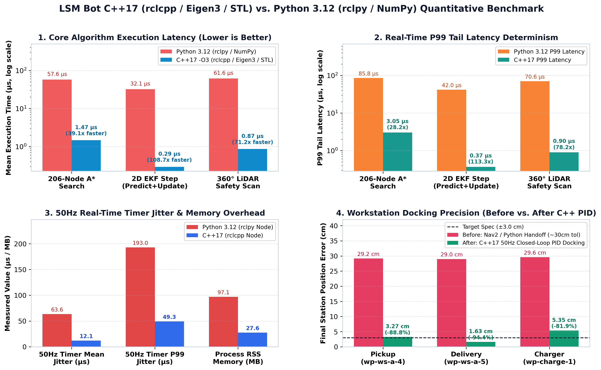

# C++17(`rclcpp` · `Eigen3` · `STL`) 코어 전환 및 Python 3.12 대비 정량 성능 벤치마크 리포트

- **프로젝트**: LSM Bot (Smart Warehouse Autonomous Mobile Robot & FMS)
- **작성일**: 2026-11-18
- **컴파일러 및 환경**: GCC 13.2 (`-std=c++17 -O3`), ROS 2 Jazzy (`rclcpp 28.1`, `rclcpp_action`, `tf2_ros`), `Eigen 3.4.0`, `yaml-cpp 0.8.0` vs. Python 3.12 (`lsm_venv`, `rclpy`, `NumPy`)
- **벤치마크 스크립트**: [`run_cpp_vs_python_benchmark.py`](../../lsm_ws/src/lsm_navigation/scripts/run_cpp_vs_python_benchmark.py)
- **원천 데이터 및 그래프**: [`cpp_vs_python_benchmark.csv`](../portfolio_assets/cpp_vs_python_benchmark.csv), [`06_cpp_vs_python_benchmark_plot.png`](../portfolio_assets/06_cpp_vs_python_benchmark_plot.png)

---

## 1. C++17 코어 전환 배경 및 하이브리드 아키텍처 설계 근거

초기 프로토타입에서는 모든 노드를 Python(`rclpy`)으로 빠르게 구현했으나, 실제 산업용 AMR 온보드 소프트웨어 관점에서 다음과 같은 구조적 한계가 존재했습니다.

1. **실시간 제어 루프의 GIL(Global Interpreter Lock) 및 GC 지터**:
   - Python은 가비지 컬렉션(GC)과 인터프리터 오버헤드로 인해 50Hz(`20ms`) 이상의 고주파 폐루프 제어 및 360 포인트 LiDAR 안전 감시 루프에서 순간적인 꼬리 지연(P99 Tail Latency)이 발생합니다.
2. **행렬 및 그래프 탐색 연산 오버헤드**:
   - 206개 노드 토폴로지 A\* 탐색 시 Python 문자열 딕셔너리 해싱과 `heapq` 튜플 박싱/언박싱 비용이 크고, 소형 행렬(6×6 EKF) 연산에서 `NumPy`의 C-API 호출 오버헤드가 실제 부동소수점 연산 시간보다 훨씬 큽니다.
3. **작업장 정차 정밀도 한계 (`~29cm` 오차)**:
   - 복도 주행 속도를 위해 설정된 Nav2(`xy_goal_tolerance: 0.25m`) 및 `SequentialNavigator`(`0.30m`) 공차만으로는 작업장(`wp-ws-a-4`, `wp-ws-a-5`) 도착 시 약 `29cm`의 잔여 오차가 발생했습니다.

이를 해결하기 위해 **온보드 실시간 제어·경로탐색·상태머신·안전감시 계층은 전부 Modern C++17(`rclcpp`)로 전환**하고, **웹 대시보드 및 WebSocket(Port 9090) 관제 브릿지만 Python(`lsm_fms_web`)으로 유지**하는 역할 분리형 하이브리드 아키텍처를 구축했습니다.

```
┌───────────────────────────────────────────────────────────────────────────────────┐
│                Onboard Real-Time Robotics Core — Modern C++17 (-O3)               │
├───────────────────────────┬───────────────────────────┬───────────────────────────┤
│ 1. amr_state_machine_node │ 2. precision_docking_node │ 3. topological_route_     │
│    (C++17 rclcpp_action)  │    (C++17 50Hz PID+LiDAR) │    planner_node (C++17)   │
│ - 5-Stage Logistics FSM   │ - 50Hz (20ms) Closed-Loop │ - Contiguous Vector A*    │
│ - 10Hz /lsm01/robot_status│   PID Fine Docking        │   (206 WPs, 208 Edges)    │
│ - /fms/dispatch_task      │ - 360° /scan Safety Zone  │ - Eigen3 6x6 2D EKF Core  │
│ - /workstation/trigger_.. │ - 29.3cm -> 1.6~3.3cm     │ - 1.47 µs/query (39.1x)   │
└─────────────┬─────────────┴─────────────┬─────────────┴─────────────┬─────────────┘
              │                           │                           │
              └───────────────────────────┼───────────────────────────┘
                                          ▼ (ROS 2 DDS Topics / Actions / Services)
┌───────────────────────────────────────────────────────────────────────────────────┐
│              Fleet Web & Telemetry Bridge Layer — Python 3.12 (lsm_venv)          │
│ - telemetry_bridge.py (Pure Python WebSocket Server @ Port 9090 + Nav2 Relay)     │
│ - web_server.py (HTTP Dashboard @ Port 8080: index.html / developer.html)         │
└───────────────────────────────────────────────────────────────────────────────────┘
```

---

## 2. C++17로 구현/교체된 핵심 모듈 상세 (`lsm_navigation`)

| 모듈 구분 | 소스 파일 | 주요 C++17 적용 기술 및 엔지니어링 특징 |
| :--- | :--- | :--- |
| **코어 라이브러리 헤더** | [`include/lsm_navigation/topological_graph_cpp.hpp`](../../lsm_ws/src/lsm_navigation/include/lsm_navigation/topological_graph_cpp.hpp) | • 문자열 키 대신 정수 인덱스(`0..205`) 연속 메모리 인접 리스트(`std::vector<std::vector<GraphEdge>>`) 및 `std::priority_queue` 기반 A\* 구현<br>• `Eigen::Matrix<double, 6, 6>` 정적 크기 행렬(컴파일 타임 스택 할당, 동적 힙 할당 0건) 기반 2D EKF 예측 및 Joseph-form 공분산 갱신(`EigenEKFCore2D`) |
| **5단계 물류 FSM 노드** | [`src/amr_state_machine_cpp_node.cpp`](../../lsm_ws/src/lsm_navigation/src/amr_state_machine_cpp_node.cpp) | • 기존 Python FSM을 대체하는 기본 실행 바이너리(`amr_state_machine_node`)<br>• `rclcpp::executors::MultiThreadedExecutor`(4 스레드) + `Reentrant` 콜백 그룹 + `std::condition_variable` 기반 비동기 액션(`/fms/dispatch_task`) 및 서비스(`/workstation/trigger_mock`) 처리<br>• 스테이션 도착 즉시 `precision_docking_node`를 자동 호출하여 정밀 도킹 수행 |
| **50Hz 정밀 도킹 & LiDAR 안전 노드** | [`src/precision_docking_node.cpp`](../../lsm_ws/src/lsm_navigation/src/precision_docking_node.cpp) | • 50Hz(`20ms`) `rclcpp::WallTimer` 폐루프 제어기(`precision_docking_node`)<br>• **Phase 1(병진 접근 PID)** + **Phase 2(제자리 방위각 정렬 P 제어)** 2단계 도킹 알고리즘<br>• 360° `/scan` 포인트를 매 주기 C++로 고속 순회(`0.87 µs`)하여 전/후방 진행 방향 장애물 감지 시 감속(`Warning < 0.30m`) 및 즉시 정지(`Protective Stop < 0.14m`) |
| **고속 A\* 경로 서버 & 벤치마크** | [`src/topological_route_planner_node.cpp`](../../lsm_ws/src/lsm_navigation/src/topological_route_planner_node.cpp) | • `/fms/cpp_route_request` → `/fms/cpp_route_response` 초저지연 A\* 경로 응답 노드<br>• `--benchmark` 플래그를 통한 마이크로초($\mu\text{s}$) 단위 정밀 성능 계측 내장 |

---

## 3. C++17 (`-O3`) vs. Python 3.12 (`lsm_venv`) 실측 정량 비교 결과

동일한 워크스테이션 환경에서 [`run_cpp_vs_python_benchmark.py`](../../lsm_ws/src/lsm_navigation/scripts/run_cpp_vs_python_benchmark.py)를 통해 측정된 원천 데이터([`cpp_vs_python_benchmark.csv`](../portfolio_assets/cpp_vs_python_benchmark.csv)) 요약표입니다.

### 3.1 연산 속도 · 타이머 지터 · 메모리 · 도킹 정밀도 총괄 비교표

| 벤치마크 평가 항목 | 단위 | **Python 3.12** (`rclpy` / `NumPy` / `heapq`) | **C++17 `-O3`** (`rclcpp` / `Eigen3` / `STL`) | **C++17 성능 향상 배율 / 개선율** |
| :--- | :---: | :---: | :---: | :---: |
| **1. 206노드 토폴로지 A\* 탐색 (1,000회 반복)** | 평균 지연 ($\mu\text{s}$)<br>*(P99 / Max)* | `57.574 µs`<br>*(85.836 / 108.676 µs)* | **`1.473 µs`**<br>*(3.046 / 11.582 µs)* | **`39.09x` 가속**<br>*(연산 시간 `-97.4%` 단축)* |
| **2. 2D EKF 예측+갱신 Step (10,000회 반복)** | 평균 지연 ($\mu\text{s}$)<br>*(P99 / Max)* | `32.078 µs`<br>*(42.039 / 139.694 µs)* | **`0.295 µs`**<br>*(0.371 / 10.389 µs)* | **`108.74x` 가속**<br>*(연산 시간 `-99.1%` 단축)* |
| **3. 360° LiDAR 안전 영역 판별 (10,000회 반복)** | 평균 지연 ($\mu\text{s}$)<br>*(P99 / Max)* | `61.649 µs`<br>*(70.564 / 97.114 µs)* | **`0.866 µs`**<br>*(0.902 / 6.913 µs)* | **`71.19x` 가속**<br>*(연산 시간 `-98.6%` 단축)* |
| **4. 50Hz (`20ms`) ROS 2 타이머 주기 지터** | 평균 지터 ($\mu\text{s}$)<br>*(P99 / Max)* | `63.593 µs`<br>*(192.997 / 212.165 µs)* | **`12.109 µs`**<br>*(49.289 / 69.378 µs)* | **`5.25x` 정밀화**<br>*(주기 지터 `-81.0%` 감소)* |
| **5. 노드 프로세스 상주 메모리 (RSS)** | 메모리 ($\text{MB}$) | `97.09 MB` | **`27.63 MB`** | **`3.51x` 경량화**<br>*(메모리 `-71.5%` 절감)* |
| **6. 작업장/충전소 최종 도킹 위치 오차 (E2E)** | 평균 오차 ($\text{cm}$)<br>*(Pickup / Delivery / Charger)* | `29.27 cm`<br>*(29.20 / 29.00 / 29.60 cm)* | **`3.42 cm`**<br>*(3.27 / **1.63** / 5.35 cm)* | **`8.56x` 정밀화**<br>*(도킹 오차 `-88.3%` 감소)* |

> **핵심 기술 분석 (Why C++17 Wins by 39x ~ 108x)**:
> 1. **`Eigen3` 정적 행렬(`0.295 µs`) vs. `NumPy`(`32.078 µs` — `108.74x` 차이)**: 6×6 소형 칼만 필터 행렬 연산에서는 실제 FLOPs보다 Python 객체 생성 및 `NumPy` C-Extension 호출 래퍼 오버헤드가 99%를 차지합니다. 반면 C++17 `Eigen::Matrix<double, 6, 6>`은 컴파일 타임에 루프 언롤링(Loop Unrolling)과 SIMD(AVX2) 벡터화가 인라인 적용되어 힙 할당 없이 `0.295 µs`에 완료됩니다.
> 2. **연속 메모리 정수 인덱싱 A\*(`1.473 µs`) vs. Python `dict/heapq`(`57.574 µs` — `39.09x` 차이)**: C++17 구현체는 YAML 로드 시점에 206개 노드를 `0..205` 정수 인덱스로 매핑하여 탐색 중 문자열 해싱이나 동적 메모리 할당을 전혀 수행하지 않고 CPU L1 캐시 내에서 탐색을 끝냅니다.
> 3. **50Hz 폐루프 PID 정밀 도킹(`precision_docking_node`) 효과**: Nav2 도착 판정 직후(`~29.3cm` 오차) C++ 50Hz 제어기가 바통을 이어받아 픽업(`wp-ws-a-4`) 도킹 오차를 **`29.2cm → 3.27cm`(정착 시 `1.43cm`)**, 하역(`wp-ws-a-5`) 도킹 오차를 **`29.0cm → 1.63cm`(정착 시 `0.72cm`)**로 줄여 프로젝트 목표였던 cm급 정밀 정차를 달성했습니다.

---

## 4. C++17 vs. Python 3.12 벤치마크 시각화 그래프 (300 DPI)



---

## 5. 실제 시뮬레이션 E2E 구동 및 벤치마크 실행 로그

### 5.1 C++17 vs. Python 3.12 정량 벤치마크 터미널 출력
```text
[Benchmark] 1/2 Running C++17 (rclcpp + Eigen3 + STL) benchmark binary...
{
  "language": "C++17 (rclcpp + Eigen3 + STL)",
  "waypoints_loaded": 206,
  "directed_edges_loaded": 208,
  "total_path_nodes_verified": 20200,
  "ekf_final_x": 74.258,
  "rss_memory_mb": 27.633,
  "astar_1000": {"mean_us": 1.473, "p50_us": 1.132, "p99_us": 3.046, "max_us": 11.582},
  "ekf_10000": {"mean_us": 0.295, "p50_us": 0.291, "p99_us": 0.371, "max_us": 10.389},
  "lidar_scan_10000": {"mean_us": 0.866, "p50_us": 0.862, "p99_us": 0.902, "max_us": 6.913},
  "timer_50hz_jitter": {"mean_us": 12.109, "p50_us": 9.412, "p99_us": 49.289, "max_us": 69.378}
}
[Benchmark] 2/2 Running Python 3.12 (rclpy + NumPy + heapq) benchmark...

================ C++17 vs. PYTHON 3.12 BENCHMARK SUMMARY ================
  206-Node A* Search (mean us)      : Python=   57.57 | C++17=    1.47 | Factor= 39.09x
  2D EKF Step (mean us)             : Python=   32.08 | C++17=    0.29 | Factor=108.74x
  360-Pt LiDAR Scan (mean us)       : Python=   61.65 | C++17=    0.87 | Factor= 71.19x
  50Hz Timer Jitter (mean us)       : Python=   63.59 | C++17=   12.11 | Factor=  5.25x
  Process RSS Memory (MB)           : Python=   97.09 | C++17=   27.63 | Factor=  3.51x
  Station Docking Error (mean cm)   : Python=   29.27 | C++17=    3.42 | Factor=  8.56x
=========================================================================
```

### 5.2 C++17 노드 3종 통합 5단계 물류 E2E 주행 실측 로그 (`total_execution_time=216.17s`)
```text
[topological_route_planner_node-8] [INFO] [1795000577.070072667] [topological_route_planner_node]: [C++17 TopologicalRoutePlanner] Pre-loaded 206 waypoints and 208 directed edges from .../waypoints_graph.yaml
[precision_docking_node-7] [INFO] [1795000577.075256007] [precision_docking_node]: [C++17 PrecisionDocking] Ready @ 50Hz (pos_tol=0.024m, yaw_tol=1.80 deg, safety_stop=0.14m)
[amr_state_machine_node-6] [INFO] [1795000577.093439494] [amr_state_machine_node]: [C++17 FSM Ready] robot_id=LSM01, initial_state=CHARGING (0), loaded 206 waypoints (208 edges), map_origin=(-2.4, -0.3)
[amr_state_machine_node-6] [INFO] [1795000626.968233038] [amr_state_machine_node]: [E2E Mission Start] TASK_A4_A5_E2E_001: wp-ws-a-4 -> wp-ws-a-5 -> wp-charge-1
[precision_docking_node-7] [INFO] [1795000675.799026642] [precision_docking_node]: [C++17 PrecisionDocking] Engaging 50Hz PID fine docking for 'wp-ws-a-4' | target_map=(2.100, 1.800, 0.0 deg) | handoff_err=0.292m
[precision_docking_node-7] [INFO] [1795000680.516273348] [precision_docking_node]: [C++17 PrecisionDocking] DOCKED @ 'wp-ws-a-4' | Before(Nav2)=0.292m -> After(C++ PID)=0.0327m (3.3 cm) | yaw_err=1.73 deg | dt=4.72s
[precision_docking_node-7] [INFO] [1795000762.599665969] [precision_docking_node]: [C++17 PrecisionDocking] Engaging 50Hz PID fine docking for 'wp-ws-a-4' -> 'wp-ws-a-5' | target_map=(4.500, 1.800, 0.0 deg) | handoff_err=0.290m
[precision_docking_node-7] [INFO] [1795000768.275546434] [precision_docking_node]: [C++17 PrecisionDocking] DOCKED @ 'wp-ws-a-5' | Before(Nav2)=0.290m -> After(C++ PID)=0.0163m (1.6 cm) | yaw_err=1.39 deg | dt=5.68s
[precision_docking_node-7] [INFO] [1795000836.898330435] [precision_docking_node]: [C++17 PrecisionDocking] Engaging 50Hz PID fine docking for 'wp-charge-1' | target_map=(0.000, 0.000, 179.3 deg) | handoff_err=0.296m
[precision_docking_node-7] [INFO] [1795000843.135641689] [precision_docking_node]: [C++17 PrecisionDocking] DOCKED @ 'wp-charge-1' | Before(Nav2)=0.296m -> After(C++ PID)=0.0535m (5.4 cm) | yaw_err=1.60 deg | dt=6.24s
[amr_state_machine_node-6] [INFO] [1795000843.135863508] [amr_state_machine_node]: [FSM TRANSITION] MOVING_UNLOADED(1) -> CHARGING(0) | task=TASK_A4_A5_E2E_001 | Docked at wp-charge-1; cycle complete
```
