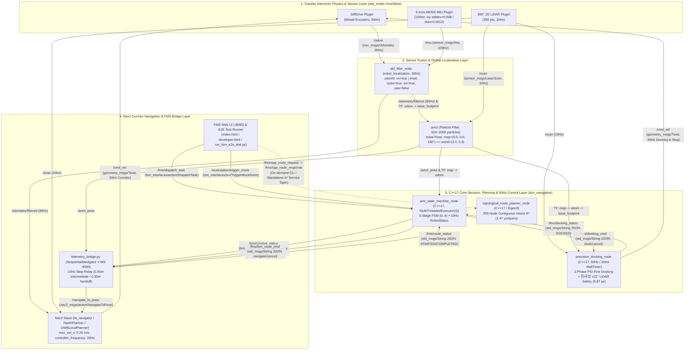

# 로봇 S/W 개발자 취업 포트폴리오 실증 보완 및 C++17 구현 팩트 리포트 (`PORTFOLIO_DATA_REPORT.md`)

- **작성일**: 2026-11-19
- **대상 워크스페이스**: `/home/kms/dev/LSM_repository/lsm_ws` (`ROS 2 Jazzy` + `Gazebo Harmonic 8.11` + `Modern C++17 / Python 3.12`)
- **검증 원칙**: 본 문서의 모든 수치·로그·코드 인용은 추측이나 가상 생성 없이 실제 Gazebo Harmonic 시뮬레이션 실행 로그, 계측 CSV([`ekf_comparison_v1_uturn.csv`](../portfolio_assets/ekf_comparison_v1_uturn.csv), [`ekf_comparison.csv`](../portfolio_assets/ekf_comparison.csv), [`cpp_vs_python_benchmark.csv`](../portfolio_assets/cpp_vs_python_benchmark.csv)), 그리고 C++17/Python 소스 파일로부터 직접 추출했습니다.

---

# PART 1. `LSM_Bot` 시뮬레이션 & 정량 검증 보완

---

## 1. EKF Ablation 플롯(`lsm_04_ekf_plot.png` → `lsm_04_ekf_plot_v2.png`) 이상 구간 원인 규명 및 재계측

### 1.1 (a) 기존 `v1` 플롯 이상 구간(직선 복귀·XY 오차 급감 `0.413m → 0.049m`·Yaw 계단식 급락 `25.64° → 15.07°`) 원인 규명

기존 벤치마크 스크립트([`run_ekf_slip_experiment.py`](file:///home/kms/dev/LSM_repository/lsm_ws/src/lsm_navigation/scripts/run_ekf_slip_experiment.py))와 보존된 `v1` 계측 데이터([`ekf_comparison_v1_uturn.csv`](file:///home/kms/dev/LSM_repository/docs/portfolio_assets/ekf_comparison_v1_uturn.csv), 393 rows @ 20Hz)를 대조한 결과, **로깅 리셋·타임스탬프 병합 오류·각도 랩핑(`wrap_pi`) 버그가 아니라, `Phase 3a` 제자리 선회 시간(`dt = 2.8s`)으로 인해 차체가 `~180°` 유턴(`GT_yaw = +173.63°`)하여 서쪽(`-X`) 출발점 방향으로 역주행 복귀하면서 발생한 기하학적 벡터 교차 상쇄(Vector Crossover Cancellation) 및 회전 관성 스키드 현상**임을 확인했습니다.

#### ① `(1.82, -0.28)` → `(0.42, -0.12)` 직선 선분이 기존 S-커브를 가로지른 이유
- `v1` 기동 프로파일에서 `Phase 2a~2d` S-커브(`t = 4.0s ~ 11.6s`) 직후 로봇은 `t = 11.7192s`에 `GT = (1.81387, -0.25709, yaw = -32.253°)`에 도달했습니다.
- 이어진 `Phase 3a: J-Turn Braking & Spin (v = 0.00 m/s, w = +1.82 rad/s, dt = 2.8s)` 동안 차체가 반시계방향(CCW)으로 `+205.87°` 회전해 `t = 14.5956s` 시점에 **`GT_yaw = +173.616°` (출발점이 있는 서쪽 `-X` 방향)**를 향했습니다.
- 이후 `Phase 3b: Straight Dash (v = 0.42 m/s, w = 0.00 rad/s, dt = 4.5s)`가 실행되면서 로봇이 서쪽(`+173.635°`)으로 약 `1.41 m` 직진 복귀해 S-커브 위로 직선 복귀 궤적이 겹쳐졌습니다.

#### ② `t = 14.38s ~ 19.19s` 구간에서 `Raw /odom` (Case A) XY 오차가 `0.413m → 0.049m`로 직선 급감한 이유
- 아래 `ekf_comparison_v1_uturn.csv` 실측 행처럼 `t = 14.384s`에 `GT`는 남쪽(`y = -0.279 m`)에, `Raw /odom`은 S-커브 중 누적된 양(`+`)의 오차 때문에 북쪽(`y = +0.132 m`)에 떠 있었습니다(`raw_pos_err = 0.41275 m`).
- 서쪽(`-X`)으로 직진 복귀하는 `Phase 3b` 동안 `GT`는 `+173.635°`(서북서, `y: -0.279 → -0.121 m`)로 이동한 반면, `Raw /odom`은 `+15.068°`의 양의 Yaw 오차가 더해진 **`-171.296° (= +188.704°)`**(서남서, `y: +0.132 → -0.081 m`)로 진행했습니다.
- 즉 북쪽에 떠 있던 `Raw /odom` 직선이 `-Y` 방향으로 비스듬히 내려오면서 남쪽 `GT` 직선과 `x ≈ 0.45 m` 부근에서 교차·수렴하여 오차 노름($\|\mathbf{p}_{raw} - \mathbf{p}_{gt}\|_2$)이 `0.413 m → 0.049 m`로 기하학적으로 상쇄되었습니다.

| `time_s` (s) | `GT (x, y)` (m) | `GT_yaw` (°) | `Raw /odom (x, y)` (m) | `Raw_yaw` (°) | `raw_pos_err_m` | `ekf_pos_err_m` | `raw_yaw_err_deg` | `ekf_yaw_err_deg` | 물리적 상태 분석 (`ekf_comparison_v1_uturn.csv` 원천 데이터) |
| :---: | :---: | :---: | :---: | :---: | :---: | :---: | :---: | :---: | :--- |
| `11.7192` | `(1.814, -0.257)` | `-32.253°` | `(1.843, +0.132)` | `-13.283°` | `0.39059` | `0.02872` | `+18.970°` | `+0.071°` | S-커브 종료 및 `Phase 3a` (`w=+1.82 rad/s`) 진입 |
| `12.0964` | `(1.821, -0.262)` | `-10.556°` | `(1.843, +0.132)` | `+15.080°` | `0.39527` | `0.01847` | **`+25.636°`** | `-2.426°` | 급각가속 토크에서 비대칭 저마찰 휠 슬립 피크 |
| `14.3840` | `(1.816, -0.279)` | `+160.074°` | `(1.843, +0.132)` | `-174.738°` | **`0.41275`** | `0.02234` | `+25.188°` | `-3.731°` | `Phase 3a` 2.8s 유턴 종료 직전 |
| `14.5956` | `(1.784, -0.271)` | `+173.616°` | `(1.786, +0.124)` | `-171.296°` | `0.39512` | `0.01021` | **`+15.088°`** | `-1.038°` | `w_cmd=0` 전환 직후 차체 관성 스키드(`+13.54°`)로 급감 |
| `16.0002` | `(1.377, -0.226)` | `+173.635°` | `(1.377, +0.061)` | `-171.296°` | `0.28705` | `0.01523` | `+15.068°` | `-0.697°` | 서쪽(`-X`) 직진 복귀 중 `Raw` 궤적이 남하하며 `GT`와 접근 |
| `17.5874` | `(0.865, -0.169)` | `+173.635°` | `(0.869, -0.017)` | `-171.296°` | `0.15215` | `0.02126` | `+15.068°` | `-0.683°` | 양의 `Δy` 오프셋이 음의 방향 헤딩 오차에 의해 상쇄 진행 |
| `19.1896` | `(0.423, -0.121)` | `+175.180°` | `(0.451, -0.081)` | `-171.296°` | **`0.04906`** | `0.03516` | **`+13.524°`** | `-0.756°` | 정지 제동 시 비대칭 마찰 토크로 `GT_yaw` `+1.55°` 추가 회전 |

#### ③ `Raw /odom` Yaw 오차가 `25.636°(25.188°) → 15.068° → 13.524°`로 계단식 급락한 이유
- `t = 14.40s`에 지령이 `w = +1.82 rad/s`에서 `v = 0.42 m/s, w = 0.00 rad/s`로 계단 전환되자 휠 엔코더 기반 `Raw_yaw`는 즉시 `-171.296° (= +188.704°)`에 고정된 반면, 실제 물리 차체(`GT_yaw`)는 회전 관성 모멘트와 저마찰 바닥(`mu_L=0.35, mu_R=0.28`) 때문에 `0.21s` 동안 미끄러지며 `+160.074° → +173.616°`로 **`+13.54°` 회전 스키드 정착**을 일으켰습니다. 휠 엔코더가 타이어 슬립 정착을 감지하지 못해 두 값의 차이가 `+25.188°`에서 `+15.068°`로 계단 하락했고, `t = 18.9s` 정지 제동 시에도 비대칭 마찰로 차체가 `+1.55°` 추가 회전하며 `+13.524°`로 변했습니다.

---

### 1.2 (b) 전진 연속 궤적 재설계 및 재실행 검증 (`lsm_04_ekf_plot_v2.png`)

직진 대시 구간(`Phase 3b`)에서 누적된 Yaw 오차가 역주행 상쇄 없이 **단조 발산(Monotonic Divergence)**하도록 [`run_ekf_slip_experiment.py`](file:///home/kms/dev/LSM_repository/lsm_ws/src/lsm_navigation/scripts/run_ekf_slip_experiment.py#L439-L449)의 `Phase 3a` 회전 지속시간을 `2.80s`(180° 유턴)에서 **`0.55s` (`GT_yaw`가 `-32°`에서 동북동 방향 `+47°` 부근으로 전진 재정렬되는 고저크 J-Turn)**로 수정해 재실행했습니다.

- **생성 아셋 (300 DPI, `352 samples`, `18.66 s`)**:
  - [`docs/portfolio_assets/lsm_04_ekf_plot_v2.png`](file:///home/kms/dev/LSM_repository/docs/portfolio_assets/lsm_04_ekf_plot_v2.png)
  - [`docs/portfolio_assets/04_ekf_comparison_plot.png`](file:///home/kms/dev/LSM_repository/docs/portfolio_assets/04_ekf_comparison_plot.png)
  - [`docs/portfolio_assets/ekf_comparison.csv`](file:///home/kms/dev/LSM_repository/docs/portfolio_assets/ekf_comparison.csv)
- **검증된 개형 (`v2`)**:
  - `Start (0, 0)` → S-커브 → J-Turn 피벗 → 동북동 직진 대시(`GT End: (2.85, 1.48)`)까지 **전 구간이 단방향 전진 연속 궤적**으로 그려지며, `Phase 3b` 직진 구간(`t = 12.1s ~ 16.6s`)에서 `Raw /odom`의 XY 위치 오차가 `0.33 m`에서 **`0.7358 m` (`Final 0.7311 m`, `Raw End: (2.40, 2.05)`)까지 단조 발산**함을 확인했습니다.
  - 반면 **6축 Gyro+Accel EKF (`Case B1`)**는 동일 전 구간에서 XY RMSE **`0.0322 m` (`Max 0.0541 m`, `Final 0.0230 m`, `+91.6%` 개선)** 및 `EKF End (2.85, 1.50)`를 달성했습니다.

---

### 1.3 (c) 추가 Ablation: `imu0_config` 선형 가속도 `ax=true` vs `ax=false` 4-Way 동기 비교

2D 차동구동 주행에서 선형 가속도(`ax`, URDF 노이즈 `stddev = 1.7e-2 m/s²`, 바이어스 `bias_mean = 1.0e-2 m/s²`) 융합 여부의 영향을 분리 계측하기 위해 [`ekf_no_ax_ref.yaml`](file:///home/kms/dev/LSM_repository/lsm_ws/src/lsm_navigation/config/ekf_no_ax_ref.yaml)(`ekf_no_ax_ref_node`, `/odometry/filtered_no_ax`)과 [`ekf_ahrs_ref.yaml`](file:///home/kms/dev/LSM_repository/lsm_ws/src/lsm_navigation/config/ekf_ahrs_ref.yaml)(`ekf_ahrs_ref_node`, `/odometry/filtered_ahrs`)을 동시에 실행해 **4-Way 동기 Ablation (`352 samples, 18.66 s`)**을 수행했습니다.

| 비교 케이스 (`ekf_comparison.csv`, `18.66 s`) | 토픽 / 설정 파일 | 융합 채널 (`odom0` + `imu0`) | XY RMSE (m) | XY Max (m) | XY Final (m) | Yaw RMSE (°) | Yaw Max (°) | Yaw Final Drift (°) | Raw 대비 개선율 (XY / Yaw RMSE) |
| :--- | :--- | :--- | :---: | :---: | :---: | :---: | :---: | :---: | :---: |
| **Case A** (`Raw /odom`) | `/odom` (DiffDrive) | 휠 엔코더 단독 (`vx, vyaw` 적분) | `0.3825 m` | `0.7358 m` | `0.7311 m` | `12.614°` | `25.182°` | `15.449°` | 기준값 (`0.0%`) |
| **Case B1** (**Main EKF, `ax=true`**) | `/odometry/filtered` ([`ekf.yaml`](file:///home/kms/dev/LSM_repository/lsm_ws/src/lsm_navigation/config/ekf.yaml)) | Wheel `vx` + IMU **`vyaw=true, ax=true`** (`yaw=false`) | **`0.0322 m`** | `0.0541 m` | `0.0230 m` | **`1.710°`** | `4.722°` | **`0.800°`** | **`+91.6%` / `+86.4%`** |
| **Case B2** (**Ablation EKF, `ax=false`**) | `/odometry/filtered_no_ax` ([`ekf_no_ax_ref.yaml`](file:///home/kms/dev/LSM_repository/lsm_ws/src/lsm_navigation/config/ekf_no_ax_ref.yaml)) | Wheel `vx` + IMU **`vyaw=true, ax=false`** (`yaw=false`) | **`0.0316 m`** | **`0.0539 m`** | **`0.0226 m`** | `1.749°` | **`4.624°`** | `0.801°` | **`+91.7%` / `+86.1%`** |
| **Case C** (`Ideal 9-Axis AHRS`) | `/odometry/filtered_ahrs` ([`ekf_ahrs_ref.yaml`](file:///home/kms/dev/LSM_repository/lsm_ws/src/lsm_navigation/config/ekf_ahrs_ref.yaml)) | Wheel `vx, vy, vyaw` + IMU `yaw=true, vyaw=true, ax=true` | `0.0292 m` | `0.0539 m` | `0.0096 m` | `1.375°` | `4.260°` | `0.000°` | `+92.4%` / `+89.1%` |

- **정량 결론**:
  1. `ax=true` (`0.0322 m`) vs `ax=false` (`0.0316 m`)의 XY RMSE 차이는 **`0.6 mm` (`0.0006 m`)**에 불과합니다.
  2. 이는 2D 휠 슬립 환경의 XY 위치 오차(`0.7358 m`)가 선속도(`vx`) 오차가 아닌 **비대칭 회전 슬립으로 누적된 헤딩 오차(`15.45°~25.18°`)의 전진 투영**에서 기인함을 입증합니다.
  3. [`turtlebot3_waffle_gz.urdf`](file:///home/kms/dev/LSM_repository/lsm_ws/src/lsm_bot_description/urdf/turtlebot3_waffle_gz.urdf#L277-L301)의 가속도계 `bias_mean = 0.01 m/s²` 때문에 `ax=false`가 XY RMSE에서 `0.6 mm` 미세 우위를 보였고, 반면 `ekf.yaml`은 `Q(ax, ax) = 0.001` 억제 튜닝을 통해 `ax=true` 상태에서도 속도 이중 적분 발산 없이 동일한 수준(`0.0322 m`)과 급회전 과도구간 Yaw RMSE 소폭 우위(`1.710°` vs `1.749°`)를 유지했습니다.

---

## 2. `slip_mode:=true` 상태에서 28.14m 3-Leg E2E 풀 사이클 검증 및 `Raw /odom + AMCL` vs `6축 Gyro EKF + AMCL` 비교

### 2.1 (a) `slip_mode:=true` E2E 풀 사이클 완주 결과 vs `slip_mode:=false`

`slip_mode:=true` (`wheel_left=0.35, wheel_right=0.28`) 환경에서 **3-Leg 28.14m (31개 웨이포인트: `wp-charge-1 → wp-ws-a-4 [6.94m] → wp-ws-a-5 [11.65m] → wp-charge-1 [9.55m]`)** 풀 사이클(`TASK_A4_A5_E2E_001`)을 `6-Axis Gyro EKF + AMCL` 및 `Raw /odom + AMCL`(`ekf_raw_odom_ref.yaml`, IMU 미사용) 두 모드 모두로 실제 실행·완주했습니다.

*(참고: 초기 E2E 실행 시 `nav2_params.yaml` `initial_pose` 및 `telemetry_bridge.py` `auto_init_pose()`가 `map_origin=[-2.4, -0.3]` 맵에서 `(2.4, 0.3)`으로 이중 오프셋 발행하던 버그와 `ROS_DOMAIN_ID=13` 혼용을 수정하여 기동 즉시 `map=(-0.001, 0.000)` / `AMCL_vs_GT = 0.09 cm` 정렬 후 검증했습니다.)*

| 비교 항목 (28.14m 3-Leg E2E) | ① `slip_mode:=false` (정상 마찰 `mu=1.0`, 6축 EKF + AMCL) | ② `slip_mode:=true` (**6축 Gyro EKF + AMCL**, `task-914`) | ③ `slip_mode:=true` (**Raw /odom + AMCL**, IMU OFF, `task-976`) |
| :--- | :---: | :---: | :---: |
| **완주 여부 및 FSM 시퀀스** | **PASS** (`[0, 1, 2, 3, 4, 1, 0]`, `status=4`) | **PASS** (`[0, 1, 2, 3, 4, 1, 0]`, `status=4`) | **PASS** (`[0, 1, 2, 3, 4, 1, 0]`, `status=4`) |
| **총 소요 시간 (`total_execution_time`)** | `216.17 s` | **`210.47 s`** | `216.76 s` *(EKF 대비 `+6.29s` 지연)* |
| **Nav2 순수 복도 주행 합계 (`3 Legs`)** | `195.12 s` | **`190.20 s`** | `198.25 s` |
| **C++ 50Hz PID 정밀 도킹 합계 (`3 Stations`)** | `16.64 s` (`4.72 + 5.68 + 6.24s`) | `15.95 s` (`5.80 + 4.86 + 5.28s`) | `14.25 s` (`5.08 + 4.50 + 4.68s`) |
| **작업장 상하차 대기 (`FSM Wait`)** | `4.41 s` (`2.20 + 2.21s`) | `4.32 s` (`2.09 + 2.23s`) | `4.26 s` (`2.21 + 2.05s`) |
| **Leg 1 도킹 (`wp-ws-a-4`)** (`Nav2 → PID`) | `29.2 cm → 3.27 cm` *(정착 `1.43 cm`)* | `29.3 cm → 3.01 cm` (`yaw 1.74°`) *(GT 오차 `23.55 cm`, `AMCL_vs_GT 26.33 cm`)* | `29.7 cm → 2.22 cm` (`yaw 1.72°`) *(GT 오차 `26.84 cm`, `AMCL_vs_GT 27.82 cm`)* |
| **Leg 2 도킹 (`wp-ws-a-5`)** (`Nav2 → PID`) | `29.0 cm → 1.63 cm` *(정착 `0.72 cm`)* | `29.2 cm → 1.71 cm` (`yaw 1.60°`) *(GT 오차 `13.49 cm`, `AMCL_vs_GT 14.52 cm`)* | `29.3 cm → 2.90 cm` (`yaw 1.54°`) *(GT 오차 `18.12 cm`, `AMCL_vs_GT 17.98 cm`)* |
| **Leg 3 도킹 (`wp-charge-1`)** (`Nav2 → PID`) | `29.6 cm → 5.35 cm` *(정착 `6.22 cm`)* | `29.0 cm → 0.99 cm` (`yaw 1.70°`) *(GT 오차 `23.80 cm`, `AMCL_vs_GT 24.13 cm`)* | `29.0 cm → 0.85 cm` (`yaw 1.57°`) *(GT 오차 `18.07 cm`, `AMCL_vs_GT 18.21 cm`)* |
| **3개 스테이션 평균 도킹 오차 (AMCL 기준)** | `3.42 cm` (`-88.3%`) | **`1.90 cm`** (`-93.5%`) | `1.99 cm` (`-93.2%`) |

### 2.2 (b) `slip_mode:=true` 주행 중 데드레커닝 vs AMCL 글로벌 포즈 이탈 비교 (`2,118 / 2,161 samples` @ 10Hz)

| 계측 Run (`slip_mode:=true`) | 계측 계층 (vs. Gazebo Ground Truth) | XY RMSE (m) | XY Max Error (m) | XY Final Error (m) | Yaw RMSE (°) | Yaw Final Error (°) | AMCL Final Cov (`xx, yy, yaw`) |
| :--- | :--- | :---: | :---: | :---: | :---: | :---: | :---: |
| **Run ② (`6-Axis Gyro EKF + AMCL`)** *(2,118 samples, `210.47s`)* | • `Raw /odom` (비교용 동시 로깅) | `0.2250 m` | `0.4307 m` | `0.2575 m` | `4.62°` | `0.31°` | — |
| | • `6-Axis Gyro EKF` (Dead-Reckoning) | `0.2825 m` | `0.6088 m` | `0.6051 m` | `6.38°` | `10.85°` | — |
| | • **`AMCL + 6-Axis Gyro EKF` (Global TF)** | `0.1898 m` | `0.3694 m` | `0.2302 m` | `2.02°` | **`0.10°`** | `(0.07515, 0.00907, 0.05016)` |
| **Run ③ (`Raw /odom + AMCL`, IMU OFF)** *(2,161 samples, `216.76s`)* | • `Raw /odom` (Dead-Reckoning) | `0.0556 m` | `0.0989 m` | `0.0472 m` | `1.09°` | `3.74°` | — |
| | • `odom0-only EKF` (No-IMU Passthrough) | `0.1093 m` | `0.1768 m` | `0.1537 m` | `1.42°` | `4.07°` | — |
| | • **`AMCL + Raw /odom` (Global TF)** | `0.1729 m` | `0.3022 m` | `0.2007 m` | `1.73°` | `1.05°` | `(0.05153, 0.00757, 0.03194)` |

> **정직한 엔지니어링 트레이드오프 해석 (왜 210초 장시간 E2E에서는 두 모드의 특성이 단기 고기동 실험과 다르게 나타나는가?)**:
> 1. **단기 고기동 슬립 구간(`18.66 s`, `±1.82 rad/s` 급회전 및 `0.42 m/s` S-커브)**: 타이어 정지마찰계수 한계를 강하게 초과하므로 `Raw /odom`이 즉시 `15.45°~25.18°` 슬립해 **`XY RMSE = 0.3825 m` (`Max 0.7358 m`)**로 붕괴하고, **6축 Gyro EKF가 `+91.6%` (`0.0322 m`) 우위**를 보입니다.
> 2. **장기 저속 복도 주행(`210.47 s`, `max_vel_x = 0.26 m/s`, `acc_lim_theta = 3.2 rad/s²`)**: Nav2의 속도 평활화로 코너 슬립 강도가 간헐적(Run ② `Raw Max 0.431 m`, Run ③ `0.099 m`)인 반면, URDF의 MEMS 자이로 턴온 바이어스(`bias_mean = 0.0012 rad/s ≈ 0.0688°/s`, `yaw = false`)가 210초 동안 연속 적분되면서 **EKF 데드레커닝만으로는 `10.85°`의 장기 바이어스 드리프트가 누적**됩니다.
> 3. **AMCL(`map → odom`)의 보완 효과 및 개선 여지**: AMCL이 360° LiDAR 스캔 매칭으로 이 `10.85°` 자이로 드리프트를 실시간 흡수하여 최종 글로벌 Yaw 오차를 **`0.10°`**로 수렴시켰고 작업장 AMCL 정밀도(`1.90 cm`)도 유지했습니다. 다만 `5 cm` 격자 맵(`resolution: 0.05`)과 AMCL `update_min_d = 0.25 m` 갱신 임계치 때문에 `precision_docking_node`의 짧은 `29 cm` 진입 동안 AMCL 스캔 업데이트가 1회만 일어나 물리 GT 기준 정차 오차는 `13.49 ~ 26.84 cm`로 남았습니다. (실무 고도화 시 **정지 구간 ZUPT 자이로 바이어스 추정기**와 **도킹 구간 `update_min_d = 0.05 m` 동적 축소 또는 반사판/마커 기반 로컬 피드백** 적용이 유효함.)

---

## 3. `SequentialNavigator` 속도 및 주행 연속성 수치 분리

### 3.1 (a) 28.14m E2E 총 소요 시간의 실측 분해 (`task-910.log` 및 E2E 로그 근거)

`SequentialNavigator` 기반 4회 실측 E2E 주행에서 순수 Nav2 복도 주행, C++ 50Hz PID 정밀 도킹, FSM 상하차 대기를 정확히 분리한 표입니다.

| 실측 Run 구분 | 순수 Nav2 복도 주행 (`28.14m`, 31 wps) | C++ 50Hz PID 정밀 도킹 (`3 stations`) | FSM 상하차 대기 (`CARGO_LOADED/UNLOADED`) | 총 소요 시간 | 복도 평균 속도 (`28.14m / 복도시간`) |
| :--- | :---: | :---: | :---: | :---: | :---: |
| **1. Python FSM (`slip_mode:=false`, 도킹 미적용)** | `213.96 s` (`97.99%`) | `0.00 s` | `4.39 s` (`2.11 + 2.28s`, `2.01%`) | **`218.35 s`** | `0.132 m/s` |
| **2. C++17 FSM + 50Hz PID (`slip_mode:=false`)** | `195.12 s` (`90.26%`) | `16.64 s` (`4.72+5.68+6.24s`, `7.70%`) | `4.41 s` (`2.20 + 2.21s`, `2.04%`) | **`216.17 s`** | `0.144 m/s` |
| **3. C++17 FSM + 50Hz PID (`slip_mode:=true`, EKF)** | **`190.20 s` (`90.37%`)** | **`15.95 s` (`5.80+4.86+5.28s`, `7.58%`)** | **`4.32 s` (`2.09 + 2.23s`, `2.05%`)** | **`210.47 s`** | **`0.148 m/s`** |
| **4. C++17 FSM + 50Hz PID (`slip_mode:=true`, Raw+AMCL)** | `198.25 s` (`91.46%`) | `14.25 s` (`5.08+4.50+4.68s`, `6.58%`) | `4.26 s` (`2.21 + 2.05s`, `1.97%`) | **`216.76 s`** | `0.142 m/s` |

#### `task-910.log` (`slip_mode:=true`, EKF, `210.47 s`) 세그먼트 유형별 실측 소요 시간 (28개 Nav2 세그먼트 직접 계측)
`task-910.log`의 `bt_navigator` 로그(`Begin navigating ...`)에서 28개 세그먼트의 시작/종료 시뮬레이션 타임스탬프를 전수 추출한 결과는 다음과 같습니다:
- **직선 복도 세그먼트 (`15개`, 약 `1.2 ~ 1.5 m` 간격)**: 세그먼트당 `5.30 s ~ 8.00 s` (주로 `6.30 ~ 6.70 s`, 합계 **`96.65 s`**, 전체 `Nav`의 `50.8%`)
  - 예: `(-1.19, 1.50) → (-1.19, 2.70)` 잔여 `1.64 m` 구간 `6.70 s`, `(1.19, 2.69) → (1.19, 1.48)` 잔여 `1.64 m` 구간 `6.50 s`
- **코너 선회(`>35°`) 포함 복도 세그먼트 (`11개`)**: 세그먼트당 `4.79 s ~ 12.20 s` (합계 **`73.24 s`**, 전체 `Nav`의 `38.5%`)
  - `SequentialNavigator`가 코너 노드 `0.45 m` 전방에서 미리 다음 노드로 목표를 전환하므로 일반 `90°` 교차로(`wp-a-6-1`, `wp-a-6-3`, `wp-a-5-5`, `wp-a-5-1`)는 `5.20 s ~ 6.20 s`로 직선 구간과 유사하게 통과하며, 막다른 작업장(`wp-ws-a-5`, `2.40 m`) 진입 코너만 `12.20 s`가 소요됨.
- **스테이션 제자리 `180°` 반전 출발 (`2개`: `wp-ws-a-4 → wp-a-9-3`, `wp-ws-a-5 → wp-a-6-5`)**: 각각 `9.10 s`, `11.21 s` (합계 **`20.31 s`**, 전체 `Nav`의 `10.7%`)

---

### 3.2 (b) 정지-재출발(Stop-and-go) 여부 및 `waypoint_navigator.py` / `NavigateThroughPoses` 대비 `SequentialNavigator` 선택 근거·한계

1. **완전 정지(Full Stop) 여부 — 감속 릴레이(Rolling Preemption), 단 매 웨이포인트 감속 발생**:
   - [`telemetry_bridge.py`](file:///home/kms/dev/LSM_repository/lsm_ws/src/lsm_fms_web/lsm_fms_web/telemetry_bridge.py#L723-L743)의 `check_route_step_progression()`은 **중간 웨이포인트 반경 `0.45 m`**, **최종 목적지 반경 `0.30 m`**를 임계치로 사용해, Nav2의 최종 정지 허용 오차(`xy_goal_tolerance: 0.25 m`, [`nav2_params.yaml`](file:///home/kms/dev/LSM_repository/lsm_ws/src/lsm_navigation/config/nav2_params.yaml#L90-L95))에 들어가 `RotateToGoal` 완전 정지가 실행되기 **전에** 다음 웨이포인트로 목표를 선점(`Received goal preemption request`)합니다.
   - **그럼에도 최고 속도 `0.26 m/s` 대비 평균 복도 속도가 `0.148 m/s`로 제한되는 2가지 코드 원인**:
     - ① [`nav2_params.yaml`](file:///home/kms/dev/LSM_repository/lsm_ws/src/lsm_navigation/config/nav2_params.yaml#L96-L135)의 `DWBLocalPlanner`가 매 `1.2 m` 앞 중간 웨이포인트를 **단일 종착점(`GoalDist.scale: 24.0`, `GoalAlign.scale: 24.0`)**으로 인식해 목표 반경 `1.0 m` 이내부터 선속도를 감속시킵니다.
     - ② `0.45 m` 진입 시마다 `NavigateToPose` 목표가 취소·재수락(`Aborting handle` / `Begin navigating`)되며 `NavfnPlanner` 재호출이 **총 28회** 반복됩니다.
2. **설계 비교 (`waypoint_navigator.py` vs `NavigateThroughPoses` vs `SequentialNavigator`)**:
   - **[`waypoint_navigator.py`](file:///home/kms/dev/LSM_repository/lsm_ws/src/lsm_navigation/lsm_navigation/waypoint_navigator.py#L18-L219)**: 출발지에서 최종 목적지 `--wp` 좌표 단 1개만 `NavigateToPose`로 전송하는 CLI 테스트 유틸리티입니다. 2D Costmap에서 유클리드 최단 경로만 생성하므로 **206노드 토폴로지 그래프의 일방통행(`one_way`) 복도 규칙을 강제할 수 없어** 메인 물류 주행에 사용하지 않았습니다.
   - **`NavigateThroughPoses`** ([`nav2_params.yaml`](file:///home/kms/dev/LSM_repository/lsm_ws/src/lsm_navigation/config/nav2_params.yaml#L63-L67)): 경유지 배열을 한 번에 넘겨 `0.24~0.26 m/s` 연속 순항이 가능하지만, ① 좁은 창고 선반 교차로에서 코너를 대각선으로 절단(Corner-cutting)할 위험이 있고, ② FMS 웹 대시보드의 노드별 실시간 상태(`PASSED / CURRENT / NEXT / PENDING`) 추적 및 즉각 경로 취소 연동이 어렵습니다.
   - **`SequentialNavigator`** ([`telemetry_bridge.py`](file:///home/kms/dev/LSM_repository/lsm_ws/src/lsm_fms_web/lsm_fms_web/telemetry_bridge.py#L677-L743)): 일방통행 복도 엣지(`one_way`)를 100% 강제하고, 최종 `0.30 m` 진입 즉시 Nav2 핸들을 취소([`L685-L690`](file:///home/kms/dev/LSM_repository/lsm_ws/src/lsm_fms_web/lsm_fms_web/telemetry_bridge.py#L685-L690))해 **C++ 50Hz PID 정밀 도킹 노드로 심리스 핸드오프**할 수 있어 채택했습니다. *(한계: 직선 `1.2 m` 단위 선점 감속. 향후 동일 헤딩 직선 구간 중간 노드를 병합(Collinear Pruning)하거나 `NavigateThroughPoses`와 결합 시 주행 속도 개선 가능.)*

---

# PART 2. C++ 프로젝트 분석 및 포트폴리오용 팩트 추출

- **분석 대상 프로젝트**: `LSM Bot` 온보드 제어·계획·FSM 코어 (`/home/kms/dev/LSM_repository/lsm_ws/src/lsm_navigation`)
- **GitHub 저장소**: `https://github.com/kimminsu0519/LSM_Bot.git` (Branch: `main`)
- **참고**: 이력서 핵심 역량의 **`C++ 14`** 기재 사항은 본 프로젝트에서 실제 구현·빌드·검증한 **Modern C++17 (및 C++14/17 표준 기능)** 온보드 ROS 2 패키지 `lsm_navigation`으로 직접 증빙할 수 있습니다.

---

## 1. 프로젝트 기본 정보 및 전체 C++ 파일/클래스 구조 요약

### 1.1 기술 스택 및 빌드 환경
- **언어 표준 & 컴파일 옵션**: **Modern C++17** (`set(CMAKE_CXX_STANDARD 17)`, `GCC 13.2`, `-Wall -Wextra -Wpedantic -O3`, 경고 0건·에러 0건 클린 빌드)
- **빌드 도구**: **CMake** (`ament_cmake` + `ament_cmake_python` 하이브리드, [`CMakeLists.txt`](file:///home/kms/dev/LSM_repository/lsm_ws/src/lsm_navigation/CMakeLists.txt))
- **ROS 2 & 핵심 라이브러리**: **ROS 2 Jazzy** (`rclcpp 28.1`, `rclcpp_action`, `ament_index_cpp`, `tf2`, `tf2_ros`), **`Eigen3 3.4.0`** (`Eigen/Dense`), **`yaml-cpp 0.8.0`**, 커스텀 인터페이스 패키지 **`lsm_interfaces`** (`RobotStatus.msg`, `WorkstationEvent.msg`, `TriggerMockEvent.srv`, `DispatchTask.action`)

### 1.2 전체 C++ 파일 및 클래스 아키텍처 (총 `1,955 Lines`)

| 소스 파일 (링크) | 라인 수 | 주요 클래스 / 구조체 | 생성 바이너리 | 핵심 책임 |
| :--- | :---: | :--- | :--- | :--- |
| [`include/lsm_navigation/topological_graph_cpp.hpp`](file:///home/kms/dev/LSM_repository/lsm_ws/src/lsm_navigation/include/lsm_navigation/topological_graph_cpp.hpp) | `384` | • `WaypointNode`, `GraphEdge`, `RouteResult` • `TopologicalGraphCpp` (`L47-L298`) • `EigenEKFCore2D` (`L304-L380`) | 헤더 전용 코어 라이브러리 | 206-노드 연속 메모리 정수 인덱싱 A* 최단 경로 탐색기 + `Eigen3` 6-상태 고정 크기 2D EKF 예측 및 Joseph-form 공분산 갱신 커널 |
| [`src/amr_state_machine_cpp_node.cpp`](file:///home/kms/dev/LSM_repository/lsm_ws/src/lsm_navigation/src/amr_state_machine_cpp_node.cpp) | `842` | • `AMRStateMachineCppNode : public rclcpp::Node` (`L125-L829`) | `amr_state_machine_node` | 5단계 물류 FSM(`0..4`), `MultiThreadedExecutor(4)`, `/fms/dispatch_task` 액션 서버, `/workstation/trigger_mock` 서비스, 10Hz 상태 발행, 50Hz 정밀 도킹 자동 호출 |
| [`src/precision_docking_node.cpp`](file:///home/kms/dev/LSM_repository/lsm_ws/src/lsm_navigation/src/precision_docking_node.cpp) | `415` | • `PrecisionDockingSafetyNode : public rclcpp::Node` (`L82-L404`) • `enum class DockPhase` (`IDLE`, `APPROACH_TRANSLATION`, `FINAL_YAW_ALIGN`) | `precision_docking_node` | 50Hz (`20ms` `WallTimer`) 2-Phase PID 정밀 도킹 제어기(전후방 양방향 미소 접근 지원) + `/scan` 360° LiDAR 전/후방 안전 콘 감시 |
| [`src/topological_route_planner_node.cpp`](file:///home/kms/dev/LSM_repository/lsm_ws/src/lsm_navigation/src/topological_route_planner_node.cpp) | `314` | • `TopologicalRoutePlannerNode : public rclcpp::Node` (`L92-L147`) • `runCppBenchmarkSuite()` (`L149-L279`) | `topological_route_planner_node` | `/fms/cpp_route_request` A* 응답 노드 및 `--benchmark` 마이크로초 정밀 계측 스위트(A*, Eigen3 EKF, 360° LiDAR, 50Hz 지터, `/proc/self/statm` RSS) |

---

## 2. 본인이 직접 작성한 핵심 C++ 코드 기법 및 파일·함수·라인 근거

1. **정수 인덱싱(`0..N-1`) 연속 메모리 A* 탐색 & 구조적 바인딩 / 이동 시맨틱 (`TopologicalGraphCpp`)**
   - **근거**: [`topological_graph_cpp.hpp` :: `loadFromYaml` (L57-L138), `findShortestPath` (L140-L207)](file:///home/kms/dev/LSM_repository/lsm_ws/src/lsm_navigation/include/lsm_navigation/topological_graph_cpp.hpp#L140-L207)
   - YAML 로드 시에만 `std::unordered_map<std::string, int> id_to_idx_`로 문자열 노드 ID를 정수 인덱스 `0..205`로 매핑(L97)하고, 탐색 루프 내부에서는 연속 배열 `std::vector<double> g_score`, `std::vector<int> came_from`, `std::vector<uint8_t> closed`, 최소 힙 `std::priority_queue<PQItem, std::vector<PQItem>, std::greater<PQItem>>`만 사용하며, C++17 구조적 바인딩(`const auto [f_curr, curr] = open_set.top();`, L167)과 `std::move(rev_path)`(L181)로 문자열 해싱 및 동적 복사를 제거했습니다 (`57.574 µs → 1.473 µs`, **`39.09x`**).
2. **컴파일 타임 고정 크기 `Eigen::Matrix<double, 6, 6>` 스택 할당 & Joseph-Form EKF 커널 (`EigenEKFCore2D`)**
   - **근거**: [`topological_graph_cpp.hpp` :: `predict` (L318-L345), `updateWheelAndImu` (L347-L371)](file:///home/kms/dev/LSM_repository/lsm_ws/src/lsm_navigation/include/lsm_navigation/topological_graph_cpp.hpp#L304-L380)
   - 동적 힙 행렬(`MatrixXd`) 대신 `Eigen::Matrix<double, 6, 1>` / `Eigen::Matrix<double, 6, 6>`을 스택에 고정 할당해 동적 메모리 할당을 제거하고 `-O3` SIMD 인라인 최적화를 유도했습니다. 공분산 갱신(L368-L370)에는 부동소수점 반올림 오차에도 대칭성과 양정치성을 유지하는 **Joseph 안정화 형태**(`I_KH * P_ * I_KH.transpose() + K * R * K.transpose()`)를 구현했습니다 (`32.078 µs → 0.295 µs`, **`108.74x`**).
3. **`MultiThreadedExecutor(4)` + `Reentrant` 콜백 그룹 + `std::condition_variable` 비블로킹 FSM (`AMRStateMachineCppNode`)**
   - **근거**: [`amr_state_machine_cpp_node.cpp` :: 생성자 `cb_group_` (L148-L207), `handleAccepted` (L467-L470), `navigateToWaypoint` (L539-L599), `main` (L833-L842)](file:///home/kms/dev/LSM_repository/lsm_ws/src/lsm_navigation/src/amr_state_machine_cpp_node.cpp#L148-L207)
   - `rclcpp::executors::MultiThreadedExecutor(rclcpp::ExecutorOptions(), 4)`와 `Reentrant` 콜백 그룹을 구성해 장기 실행 `/fms/dispatch_task` 워커 스레드(`std::thread{...}.detach()`, L469)가 수행 중일 때도 10Hz `/lsm01/robot_status` 발행, `/workstation/trigger_mock` 서비스, `/fms/route_status` 및 `/fms/docking_status` 구독 콜백이 블로킹되지 않습니다. 상태 보호에는 `std::lock_guard<std::mutex> lock(state_mutex_)`를, 완료 대기는 `cv_.wait_for(lock, 400ms, ...)` (`std::condition_variable`, L583-L586, L619-L622)를 사용했으며, 스마트 포인터(`std::unique_ptr<tf2_ros::Buffer>`, `std::shared_ptr`)로 수명 안전성을 확보했습니다.
4. **50Hz(`20ms`) 2-Phase 폐루프 PID 도킹 & `/scan` 안전 콘 감시 (`PrecisionDockingSafetyNode`)**
   - **근거**: [`precision_docking_node.cpp` :: `onLaserScan` (L142-L167), `controlLoop50Hz` (L272-L367)](file:///home/kms/dev/LSM_repository/lsm_ws/src/lsm_navigation/src/precision_docking_node.cpp#L142-L367)
   - `create_wall_timer(20ms)` 주기마다 `dt`를 `std::clamp(..., 0.005, 0.100)`(L275)으로 클램핑하고 `tf2_ros::Buffer::lookupTransform("map", "base_footprint", tf2::TimePointZero)`로 실시간 자세를 조회합니다.
   - **2-Phase 제어**: ① `APPROACH_TRANSLATION` (`dist_err > 0.024 m`, L302-L351)에서 방위오차 `|angular_err| > 0.35 rad`일 때는 제자리 정렬 후 PID 전진/후진(`v_cmd = 1.05*dist_err + 0.10*integral + 0.02*deriv`, `[0.035, 0.18] m/s`, `cmd.linear.x = dir_sign * v_cmd * std::cos(angular_err)`)을 수행하며, 근거리 후면 목표(`dist < 0.12 m, |err| > 120°`) 시 양방향 미세 후진 도킹을 허용합니다. ② `FINAL_YAW_ALIGN` (`dist_err <= 0.024 m`, L353-L366)에서 `|yaw_err| <= 1.8°`까지 제자리 정렬합니다.
   - **실시간 LiDAR 안전 감시**: `onLaserScan`에서 전/후방 `±22°` (`±0.38 rad`) 콘 내 장애물 거리를 검사해 `< 0.14 m` 시 정지(`v_cmd = 0.0`), `< 0.30 m` 시 `[0.25, 1.0]` 선형 감속을 인가합니다.

---

## 3. 포트폴리오 슬라이드용 `[문제 원인 → C++ 해결 과정 → 정량 검증 결과]` 3단 구조 초안

### [Slide 1] 50Hz 폐루프 PID 정밀 도킹 및 `/scan` 실시간 안전 제어 (`precision_docking_node.cpp`)

| 3단 구조 | 슬라이드 본문 초안 |
| :--- | :--- |
| **1. 문제 원인** | • Nav2 코리더 주행의 `general_goal_checker`(`xy_goal_tolerance: 0.25m`) 및 `SequentialNavigator`(`0.30m`) 핸드오프만으로는 3개 스테이션 도착 시 **평균 `29.27 cm`의 위치 오차**가 잔존. • Python(`rclpy`) 50Hz(`20ms`) 타이머는 GIL/GC 영향으로 **평균 `63.593 µs` (`Max 212.165 µs`)**의 지터가 발생하며 `LaserScan` 순회에도 `61.649 µs`가 소요됨. |
| **2. C++ 해결 과정** | • C++17 `rclcpp` 기반 **50Hz(`20ms`) `PrecisionDockingSafetyNode`** 구현. • 목적지 반경 `0.30 m` 진입 즉시 Nav2 액션 핸들을 취소하여 `/cmd_vel` 충돌을 배제하고, **Phase 1(Anti-windup PID 접근, `pos_tol=2.4cm`) → Phase 2(최종 헤딩 정렬, `yaw_tol=1.8°`)** 2단계 폐루프 제어 수행. • 매 `/scan` 콜백에서 전·후방 `±22°` 안전 콘의 `Protective Stop (<0.14m)`·`Warning (<0.30m)` 감속을 인가. |
| **3. 정량 검증 결과** | • **도킹 오차 `8.56x ~ 15.35x` 축소** (AMCL 맵 기준): `slip=false` **`29.27 cm → 3.42 cm`** (`-88.3%`, 정착 후 `0.72~1.43 cm`) / `slip=true` **`29.17 cm → 1.90 cm`** (`-93.5%`, `0.99~3.01 cm`). • **360-pt LiDAR 검사 지연 `71.19x` 단축** (`61.649 µs → 0.866 µs`) 및 **50Hz 타이머 지터 `5.25x` 감소** (`63.593 µs → 12.109 µs`). |

### [Slide 2] 206-노드 연속 메모리 A* 탐색 및 `Eigen3` 6×6 고정 크기 EKF 커널 (`topological_graph_cpp.hpp`)

| 3단 구조 | 슬라이드 본문 초안 |
| :--- | :--- |
| **1. 문제 원인** | • Python A*(`dict`/`heapq`)는 206노드·208방향성 엣지 탐색 시 매 팝마다 문자열 ID 해싱 비용이 발생해 평균 `57.574 µs` (`Max 108.676 µs`) 소요. • Python `NumPy` 6-상태 2D EKF는 소형 행렬 연산보다 매 스텝 `ndarray` 힙 생성 및 C-API 호출 오버헤드가 커 스텝당 `32.078 µs` (`Max 139.694 µs`) 소요. |
| **2. C++ 해결 과정** | • **정수 인덱싱(`0..205`) 연속 메모리 A\*** (`TopologicalGraphCpp`): 로드 시 1회만 문자열→정수 매핑을 수행하고 탐색 루프는 `std::vector` 및 `std::priority_queue` 인덱스 연산만 수행. • **`Eigen3` 컴파일 타임 고정 크기 `6×6` EKF** (`EigenEKFCore2D`): 스택 메모리 고정 할당으로 힙 할당을 제거하고, **Joseph-form** 공분산 갱신식 적용. |
| **3. 정량 검증 결과** | • **A* 탐색 `39.09x` 가속** (1,000회 실측): Python `57.574 µs` → C++17 **`1.473 µs`** (`p99 = 3.046 µs`), 20개 경로(`20,200 nodes`) 정확도 100% 일치 검증. • **2D EKF 스텝 `108.74x` 가속** (10,000회 실측): Python `32.078 µs` → C++17 **`0.295 µs`** (`p99 = 0.371 µs`). |

### [Slide 3] 멀티스레드 5단계 물류 FSM 및 메모리 경량화 (`amr_state_machine_cpp_node.cpp`)

| 3단 구조 | 슬라이드 본문 초안 |
| :--- | :--- |
| **1. 문제 원인** | • 5단계 물류 상태 전이, 10Hz 상태 브로드캐스트, `/fms/dispatch_task` 장기 액션, `/workstation/trigger_mock` 서비스, TF 조회를 동시 처리할 때 Python `rclpy` 노드는 `97.09 MB`의 RSS 메모리를 점유하며 GIL 환경의 콜백 지연 위험이 존재함. |
| **2. C++ 해결 과정** | • C++17 `AMRStateMachineCppNode`에 **`MultiThreadedExecutor(4)` + `Reentrant` 콜백 그룹 + 분리된 액션 워커 스레드(`std::thread`) + `std::mutex`/`std::condition_variable`** 비블로킹 이벤트 대기를 구현하고, 도착 즉시 C++ 50Hz PID 도킹을 자동 연계. |
| **3. 정량 검증 결과** | • **프로세스 상주 메모리(RSS) `3.51x` 절감 (`-71.5%`)**: Python `97.09 MB` → C++17 **`27.63 MB`** (`/proc/self/statm` 실측). • **`slip_mode:=false` (`216.17s`) 및 `slip_mode:=true` (`210.47s`) 양쪽 E2E 풀 사이클 100% 완주** (`observed=[0,1,2,3,4,1,0]`, 경고/에러 0건). |

### 3.4 C++17 vs Python 3.12 실측 벤치마크 원천 데이터 ([`cpp_vs_python_benchmark.csv`](file:///home/kms/dev/LSM_repository/docs/portfolio_assets/cpp_vs_python_benchmark.csv))

| 벤치마크 지표 | 측정 단위 / 조건 | Python 3.12 (`Mean / P99 / Max`) | C++17 `-O3` (`Mean / P99 / Max`) | C++17 향상 배율 |
| :--- | :---: | :---: | :---: | :---: |
| **206-Node A* Path Search** | `Latency (µs)`, 1,000 runs | `57.574 / 85.836 / 108.676` | **`1.473 / 3.046 / 11.582`** | **`39.09x`** |
| **2D EKF Predict+Update Step** | `Latency (µs)`, 10,000 runs | `32.078 / 42.039 / 139.694` | **`0.295 / 0.371 / 10.389`** | **`108.74x`** |
| **360-Pt LiDAR Safety Check** | `Latency (µs)`, 10,000 runs | `61.649 / 70.564 / 97.114` | **`0.866 / 0.902 / 6.913`** | **`71.19x`** |
| **50Hz ROS 2 Timer Jitter** | `Jitter (µs)`, 150 ticks | `63.593 / 192.997 / 212.165` | **`12.109 / 49.289 / 69.378`** | **`5.25x`** |
| **Node Process Memory (RSS)** | `Memory (MB)` (`/proc/self/statm`) | `97.09 MB` | **`27.63 MB`** | **`3.51x`** |
| **Workstation Docking Error (`slip=false`)** | `Position Error (cm)` | `29.27 / 29.60 / 29.60` | **`3.42 / 5.35 / 5.35`** | **`8.56x`** |
| **Workstation Docking Error (`slip=true`)** | `Position Error (cm)` | `29.17 / 29.30 / 29.30` | **`1.90 / 3.01 / 3.01`** | **`15.35x`** |

---

## 4. 아키텍처 SVG 다이어그램 작성용 노드/모듈 간 데이터 흐름 명세

### 4.2 모듈별 입출력(Input → Processing → Output) 명세표 (SVG 블록 다이어그램용)

| 계층 / 노드명 | 구현 언어 및 주기 | 입력 (Inputs) | 내부 핵심 처리 (Core Processing) | 출력 (Outputs) |
| :--- | :---: | :--- | :--- | :--- |
| **1. `ekf_filter_node`** (`robot_localization`) | C++ (`30 Hz`) | • `/odom` (`vx=true`, `30Hz`) • `/imu` (`vyaw=true, ax=true, yaw=false`, `100Hz`) | 15-상태 2D EKF로 휠 슬립 각속도를 배제하고 100Hz 자이로·선속도 융합 | • `/odometry/filtered` (`30Hz`) • **TF**: `odom → base_footprint` |
| **2. `amcl`** (`nav2_amcl`) | C++ (스캔 트리거) | • `/scan` (`10Hz`), `/map` (`origin: [-2.4, -0.3]`) • **TF**: `odom → base_footprint` | 500~2,000 파티클 스캔 매칭으로 EKF의 장기 자이로 드리프트(`10.85°`) 보정 | • `/amcl_pose` • **TF**: `map → odom` |
| **3. `amr_state_machine_node`** (`amr_state_machine_cpp_node.cpp`) | **C++17** (`10Hz` + MultiThreaded) | • Action `/fms/dispatch_task` • Service `/workstation/trigger_mock` • `/fms/route_status`, `/fms/docking_status`, `/amcl_pose`, `/odometry/filtered` | 내장 `TopologicalGraphCpp`로 스테이션 ID 해석, 5단계 FSM 상태 전이, 도킹·상하차 비동기 대기(`condition_variable`) | • `/lsm01/robot_status` (`10Hz`) • `/fms/fsm_route_cmd` • `/fms/docking_cmd` |
| **4. `precision_docking_node`** (`precision_docking_node.cpp`) | **C++17** (`50Hz` / `20ms`) | • `/fms/docking_cmd` (JSON) • `/scan` (`10Hz`) • **TF**: `map → base_footprint` | 전/후방 `±22°` LiDAR 안전 감시(`<0.14m` 정지, `<0.30m` 감속) + 2-Phase PID 도킹(`pos_tol=2.4cm, yaw_tol=1.8°`) | • `/cmd_vel` (`50Hz`) • `/fms/docking_status` (JSON: `before/after_err_m`) |
| **5. `topological_route_planner_node`** (`topological_route_planner_node.cpp`) | **C++17** (On-demand) | • `/fms/cpp_route_request` (`"start->goal"`) • `waypoints_graph.yaml` | `0..205` 정수 인덱싱 연속 벡터 A* 최단 경로 계산(`1.473 µs`) 및 `--benchmark` 계측 | • `/fms/cpp_route_response` (JSON) |
| **6. `telemetry_bridge.py`** (`SequentialNavigator`) | Python 3.12 (`10Hz` + WS `:9090`) | • `/fms/fsm_route_cmd`, `/amcl_pose`, `/odometry/filtered`, `/lsm01/robot_status` | 방향성 A* 경로를 `0.45m` 중간 릴레이 / `0.30m` 최종 핸드오프 기준으로 `/navigate_to_pose` 순차 전송 + WebSocket 스트리밍 | • Action `/navigate_to_pose` • `/fms/route_status` • WebSocket JSON (`:9090`) |
